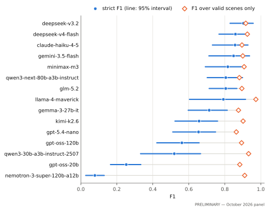
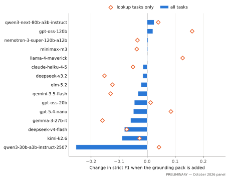

<!-- Built by paper/build.py from paper/sections/ and paper/generated/values.json (October 2026 panel, PRELIMINARY). Do not edit: edit the sections. -->

# MolBench: grading language models on what a molecular viewer would show

⟦PENDING: Dan — author list, affiliations, corresponding author⟧

> **Draft status.** Numbers in this draft come from the *October 2026 panel* (PRELIMINARY).
> Every number is written by `scripts/paper_tables.py`; none is typed by hand. Results labelled
> PRELIMINARY will be replaced by the final run. Parts of the design that are not yet built, and
> numbers only the final run can supply, carry a visible PENDING tag in double brackets and are
> listed in
> `paper/PENDING.md`.

## Abstract

Researchers increasingly ask computational intelligence (CI) assistants to drive molecular
viewers in plain language: "show the haem", "highlight the residue changed by this variant".
There is no agreed way to measure whether the result is right. We present MolBench, a benchmark
that grades a language model on **what the viewer would show**: which atoms are selected, and how
they are drawn and coloured. Every reference answer is built by script from the deposited
structure and tested against it. The same requests are posed in two output formats, a declarative
scene (MolViewSpec) and an imperative call list (the PDBe Mol\* viewer API), so that not knowing
the biology can be told apart from not being able to write the format. Difficulty rises from
translating a fully specified request, to requests that need facts about the structure, to
clinical-variant requests that need a mapping from UniProt numbering to the residues of a
structure. In a preliminary panel of 15 models on 70 scene tasks,
strict scores ranged from 0.08 to 0.90. Almost all of that
range came from whether the output was a valid scene at all (correlation between valid-scene rate
and score: r = 0.996). Over valid scenes only, models were close
(0.86 to 0.97). Clinical tasks scored lowest,
but 85 of 96 valid clinical
scenes drew the requested residue exactly; most points were lost on parts of the scene that the
request did not specify. Adding frozen facts about the structure to the request did not
help (mean change -0.041). ⟦PENDING: replace the preliminary numbers
with the final run (both tracks, three samples per task) and add the paired-format result⟧
The tasks, references, graders, raw model outputs and the scripts that produce every number in
this paper are openly available.

## 1. Introduction

Molecular viewers are how structural biologists look at their data. They are also hard to drive.
To show one residue in one chain, a user must know the viewer's selection language, the chain
identifier, and which of two residue numbering schemes the viewer expects. Language models
promise to remove that barrier: the user says what they want and the model writes the commands.
Several viewers now ship such assistants, or expose themselves to one through a tool protocol
[1, 2, 3, 4].

Whether these assistants are right is rarely measured. A wrong scene looks as polished as a
correct one. A model that colours residue 175 of the wrong chain, or residue 175 by the wrong
numbering scheme, still produces a clean picture. For a clinical variant, that picture points a
reader at the wrong amino acid. The problem is not rare: a survey of the Protein Data Bank found
that more than a third of entries contain proteins that are not numbered as their UniProt sequences
are (38.6% of the 176,507 entries examined) [5].

We built MolBench to measure this. It rests on four choices.

**Grade what the viewer would show.** A model's answer is resolved to the set of atoms it selects
in the real structure, and to how those atoms are drawn and coloured. Two answers that name the
same atoms in different ways score the same. An answer that selects nothing scores nothing. The
grader never compares text with text.

**Build every reference by script.** No reference answer is written from memory. Each one is
produced by a script from the deposited structure and public annotation, records how it was
made, and is tested against the structure.

**Ask the same question in two formats.** Each request is posed once for a declarative scene
description, MolViewSpec [6, 7], and once for an imperative call list
against the PDBe Mol\* viewer [8, 9]. If a model picks the right atoms in one
format and not in the other, the fault lies in writing the format, not in the biology.

**Raise the difficulty in known steps.** Tasks range from translating a fully specified request,
through requests that need facts about the structure (which ligand, which disulfide bonds), to
requests about clinical variants. A variant is reported in UniProt numbering [10, 11]. To show it, a model must find the matching residue in the structure, which
needs the residue-level mapping kept by SIFTS [12].

This paper makes three contributions.

1. A benchmark of ⟦PENDING: final task count (target: about 300 across both tracks)⟧ tasks on
   ⟦PENDING: final structure count (target: at least 50 PDB entries)⟧ structures, with references
   that are correct by construction, in two output formats, with follow-up turns and a small set
   of requests that have more than one right answer.
2. A grader based on resolved atoms and final viewer state, with an explicit account of invalid
   output. We report a strict score, a score over valid outputs only, and what an offline repair
   of broken JSON would have changed.
3. Findings from a panel of current models, including two null results that we report as
   findings: frozen grounding facts did not raise scores, and without a copy of the format
   reference no model produced a valid scene.

We use "computational intelligence (CI)" for what is often called artificial intelligence.

## 2. Related work

We checked every work below against its source on 2026-11-12. Where we say a benchmark lacks
something, we mean that we did not find it in the paper; we do not claim to be first or only.

### 2.1 Benchmarks that score control of scientific software

**ScienceBoard** [13] is the closest published benchmark. It has 169 tasks in
six domains, performed by agents that operate a desktop through screenshots and clicks. Its
biochemistry domain uses UCSF ChimeraX [14], and tasks are checked by reading
the state of the application after the agent has finished. MolBench shares the idea of checking
the resulting state. It differs in four ways. It tests the translation from request to commands
directly, without a desktop in between. Its references are built by script and carry their
provenance. It has graded regimes of difficulty, up to clinical variants. And it poses each
request in two output formats.

**SciVisAgentBench** [15] has 108 expert-written cases of scientific
visualization. Its molecular cases use GROMACS and VMD. Outcomes are scored by a language-model
judge against written rubrics, together with deterministic checks for some suites. The authors
validated the judge against 12 visualization experts and report an inter-rater agreement
(Krippendorff's alpha) of 0.669 and a correlation between judge and human scores of about 0.81.
MolBench is narrower and stricter. It covers only molecular viewers, its main score needs no
judge model, and its human rating study (Section 4.5) is smaller and serves only to check a side
column.

**OSWorld-Science** [16] follows the OSWorld desktop benchmark
[17] with 146 tasks over scientific applications, one of which pairs PyMOL with an
NMR package. Evaluators inspect application state and output files and give partial credit. The
overlap with MolBench is small: a molecular viewer is one application among many, and the tasks
test the operation of a graphical interface.

General benchmarks of tool use, such as ToolLLM [18] and tau-bench
[19], measure whether a model calls the right function with the right arguments.
MolBench's call-list track has that shape. The difference is the check. A viewer call is right
only if its selection resolves to the right atoms in a particular structure, and the benchmark
checks that.

### 2.2 Assistants for molecular viewers, without a control benchmark

**Speak to a Protein** [3] is a co-scientist that answers questions about a
protein while driving a browser viewer built on the Mol\* engine. Its evaluation covers question
answering. The paper lists viewer operations as one of its task groups but reports no accuracy
for them. **ChatMol Copilot** [4] is an agent for molecular modelling that includes
PyMOL control. **ChimeraX** can be operated from a chat assistant through a built-in tool server;
its documentation notes that the assistant "will often make mistakes" [1]. **VOICE**
[20] and a speech interface for an immersive molecular-graphics application
[21] control molecular scenes by spoken language and were evaluated with users,
not with scored tasks. The Mol\* project has merged an optional assistant and a command-language
layer into its next viewer [2]. We found no published benchmark from that work.
A community tool that builds MolViewSpec scenes from chat [22] states in its
documentation that the residue numbers researchers take from ClinVar, publications and mutation
databases "are always author numbers". That holds for some entries and fails for many
[5]. It is the error our clinical tier is built to catch.

### 2.3 The data and software MolBench stands on

MolViewSpec describes a molecular scene as a tree of typed nodes and is implemented as an
extension of the Mol\* viewer [6, 7, 23]. The
call-list track targets the PDBe build of Mol\* [8] through its notebook widget
[9]. Structures come from the Protein Data Bank [24] and, where a task uses a
predicted model, the AlphaFold Protein Structure Database [25]. The mapping between UniProt
residues and the residues of a structure comes from SIFTS [12], as distributed with
PDBe-KB [26, 27]. Variants and their clinical significance come from ClinVar
[11] through UniProt [10]. Structure files are read with GEMMI
[28].

The numbering problem at the centre of the clinical tier has been met from another side. Vollmar
and colleagues find residue mentions in the crystallographic literature and map them to
structures through SIFTS [29]. Their system reads papers; ours asks whether a
model can do the same mapping when it draws a scene.

### 2.4 Nearby work that does not overlap

MiSI-Bench [30] asks vision-language models questions about rendered images of
molecules and finds them well below human level. That is evidence for caution in using such a
model as an image judge, which is how we treat ours (Section 4.4).

## 3. Benchmark design

This section describes the benchmark as it will be at the final run. Parts not yet built are
tagged. The preliminary results in Section 6 were obtained on an earlier, smaller corpus, which
is described there.

### 3.1 What a task is

A task has four parts:

- a **request** in plain language, as a user would type it;
- a **reference answer** in the output format of its track;
- a **provenance record**: the script that built the reference, the data it read, and the
  structural facts it relied on (for example, "UniProt P04637 position 175 = chain A, author
  residue 175");
- a frozen **grounding pack**: a short block of facts about the structure, used only in one
  ablation (Section 5.2).

The model sees the request and a fixed system prompt. It returns one answer. Nothing is
executed for the model, and it cannot look anything up: the benchmark is closed-book.

### 3.2 Two tracks

**MVS track (headline).** The model writes a MolViewSpec scene: a JSON tree whose nodes download
a structure, parse it, pick components (sets of atoms), give each a representation and a colour,
and optionally add labels, drawn lines or a camera focus [6]. A scene is
declarative. It says what should be visible, not how to get there.

**API track.** The model writes an ordered list of calls for the PDBe Mol\* viewer, in the form
exposed by its notebook widget [8, 9]: load an entry, set the global style,
colour or highlight a selection, focus, hide water, and so on. A call list is imperative. Order
matters, and a later call can overwrite an earlier one. The target is fixed at pdbe-molstar
3.3.2, the version that ipymolstar 0.1.0 loads.

For both tracks the format reference is a frozen document stored in the repository. It is shown
to the model, and it is the authority the grader follows.

The API track cannot do everything a scene can, and the reverse. In particular, the PDBe viewer
has no selection by distance or by property and cannot superpose two arbitrary structures. We do
not test those operations in either track.

### 3.3 Regimes of difficulty

A regime is a group of tasks that need the same kind of knowledge. Three regimes form a
gradient:

1. **Translation.** The request states everything: the entry, the chain or residue range, the
   representation, the colour. The model only has to translate. References are built with the
   MolViewSpec builder library [7] from a template and a structure.
2. **Structure-grounded.** The request names a feature and not its location: "the haem", "the
   disulfide bonds". The model must know or infer which atoms that is. References are extracted
   from the deposited file with GEMMI [28].
3. **Clinical.** The request names a variant or a residue by its UniProt position, as clinical
   databases do. The model must work out which residue of which chain in the structure that is.
   References are built from the UniProt variant records [10, 11] and
   the SIFTS residue mapping [12], both frozen in the repository.

Two further regimes test other skills and are not steps on the gradient:

4. **Resolution.** The request names a protein and no entry ("show green fluorescent protein").
   Any entry from a frozen list of accepted entries counts as the right structure.
5. **Interactions.** The request asks for specific contacts, such as the hydrogen bonds to a
   ligand, drawn between named atoms. Each atom is checked against the deposited file.

The clinical tier of the preliminary corpus had a weakness that the final corpus removes. All of
its tasks used one structure (1TUP, the p53 core domain), where UniProt numbering happens to
equal author numbering. Those tasks test whether a model picks the right chain. They cannot test
whether it converts a UniProt position to a different author number. The final clinical tier has
⟦PENDING: final count (target: at least 40 tasks on at least 12 proteins, at least 8 of them with
a UniProt-to-author offset)⟧.

### 3.4 Structures

Tasks on the same structure are not independent: a model that knows haemoglobin well gains on
all of them. The final corpus therefore spreads tasks over ⟦PENDING: final structure count
(target: at least 50 PDB entries; the preliminary corpus has 14)⟧, and all
confidence intervals resample whole structures (Section 4.6). For each structure the repository
holds a frozen atom table, a frozen SIFTS mapping and the grounding facts, so grading needs no
network access.

### 3.5 Paired tasks

Every MVS task that the API can express has an API twin: the same request and the same target
atoms. Twins let us compare formats on identical content. For each model and each pair we record
whether each twin was a full success, and we test the difference with McNemar's test for paired
proportions [31].

Clinical twins are not a clean comparison, and we flag them. The PDBe viewer accepts a UniProt
accession and residue number and does the mapping itself. In the API track a clinical request
can therefore be answered without knowing the mapping. In the MVS track it cannot. We report the
paired analysis with and without clinical twins.
⟦PENDING: number of pairs in the final corpus⟧

### 3.6 Follow-up turns

Real use is a conversation. The second request edits the scene the first one made: "now colour
the ligand red". ⟦PENDING: follow-up tier (target: about 30 two-turn tasks in both tracks)⟧ Each
such task gives the model a starting scene and an edit request. Only the final state is graded,
so a model that carries out the edit and loses an earlier choice (it recolours the ligand and
drops the surface) loses points.

### 3.7 Requests with more than one right answer

Some honest requests are ambiguous. "Show the binding site" does not say how. For a small tier
⟦PENDING: accept-set tier (target: about 15 tasks)⟧ a script builds several accepted final
states, and the task is scored against the best-matching one. We do not use a judge model for
these tasks.

### 3.8 What is not in this benchmark

Open-ended requests that can only be judged by eye ("make a figure that shows why this mutation
matters") are out of scope here and are future work. So are agents that call tools in a loop.
We tested the premise for a tool loop, namely that giving the model looked-up facts raises its
score, and it did not hold (Section 6.4).

## 4. Grading

### 4.1 One idea for both tracks

An answer is graded on what the viewer would show. For a scene, that is the set of components:
which atoms, in which representation, in which colour, plus any drawn lines, labels and camera
focus. For a call list, it is the state of the viewer after the calls have run in order.

**Atom sets.** Every selection, in the answer and in the reference, is resolved against the
frozen atom table of the structure, following the selection rules of the viewer (Mol\* 5.9.0 for
scenes, pdbe-molstar 3.3.2 for call lists). Three consequences follow.

- Different names for the same atoms score the same. "All cysteines" equals the cysteines listed
  one by one.
- The two numbering schemes are kept apart. A structure file carries *author* numbering (chosen
  by the depositor, and often following the UniProt sequence) and *label* numbering (a plain
  count along the sequence in the file). In 1TUP, author chain A is the protein, and label chain
  A is a DNA strand. An answer that uses the wrong scheme selects the wrong atoms and is scored
  on those.
- A selection that matches no atom earns nothing.

**F1.** For the MVS track, the reference scene and the answer are each flattened into paths from
the root to each leaf (for example: entry 1TUP → protein → cartoon → grey). Reference paths are
matched to answer paths. A matched pair earns a similarity between 0 and 1. For a component, the
similarity is the overlap of the two atom sets, measured as the number of shared atoms divided
by the number of atoms in either (the Jaccard index). *Precision* is the total similarity
divided by the number of answer paths: it falls when the answer shows things that were not asked
for. *Recall* is the total similarity divided by the number of reference paths: it falls when
the answer leaves things out. **F1** is the harmonic mean of the two, from 0 (nothing right) to
1 (everything right and nothing extra).

**Task success.** An answer is a *success* if it is valid and its F1 is exactly 1: the final
state is right in every graded respect. F1 gives partial credit and is the smoother measure.
Success is what a user needs. We report both everywhere.

For the API track, the grader replays the calls against a model of the viewer state and compares
the final state with the reference state on the same terms.
⟦PENDING: API state-replay grader (`molbench/pdbe_state.py`) — describe exactly what state is
compared once it is merged⟧ An earlier API grader compared call lists field by field. Section 6.7
shows why it was replaced.

### 4.2 What happens to each output

Each output falls into exactly one class.

| Class | Meaning | Score |
|:---|:---|:---|
| Valid | Parses as JSON; the viewer accepts it; the structure loads | graded, 0 to 1 |
| Invalid JSON | No JSON object can be parsed from the output | 0 |
| JSON, not a scene | Valid JSON, but not an answer in the required format | 0 |
| Rejected by the viewer | Right format, but with a node or parameter the viewer refuses | 0 |
| Structure failed to load | Well formed, but it names a file that does not load | 0 |

Validity is checked by the viewer itself, in a headless browser, and not by a schema of our own.

### 4.3 Three scores, so that validity is reported and not hidden

- **Strict score** (primary). Mean over all outputs. Anything the viewer cannot show scores 0.
  This is what a user of the model would experience.
- **Score over valid outputs.** Mean over the valid outputs only. It asks: when the model does
  produce a scene, how good is the scene? It must be read with the valid-output rate next to it,
  because a model with few valid outputs is scored on few outputs.
- **Repaired score** (counterfactual). Each invalid-JSON output is passed through an open-source
  JSON repair library [32] and graded again. No model is called. This estimates how
  much of the loss is a formatting slip that a wrapper could fix. Repaired scenes are graded as
  trees but are not checked by the viewer, so the repaired score is an upper bound.

### 4.4 Render check (a side column)

The tree comparison can be too strict. Two scenes that differ as trees can look the same. As a
check, every valid scene that scores below 1 is rendered next to its reference at a fixed
camera. If the two images are near-identical pixel for pixel, or if an image-pair judge (a
vision-capable language model) calls them the same, the scene is *rescued* and counted as
correct. The result is the *validated F1*. It is reported as a side column and never replaces
the strict score, for two reasons: the judge is a model with its own errors
[30], and rescue can only raise a score.

### 4.5 Human rating study

To find out how far the image-pair judge can be trusted, human raters see the same image pairs,
blind to the model and to the judge's verdict, and say whether the two images show the same
thing. Known-identical pairs are mixed in as attention checks. Each pair is rated by two people.
We report agreement between raters, agreement between raters and the judge, and how often a
rescue by the judge is confirmed by a human.
⟦PENDING: rating-study readout — number of raters, pairs and ratings; human–human and
human–judge agreement with intervals; share of judge rescues confirmed⟧

### 4.6 Uncertainty

Tasks on one structure are correlated, so we do not treat tasks as independent. All 95%
confidence intervals come from a bootstrap [33] that resamples whole structures: all
tasks on a drawn structure enter together. We use 10,000 replicates and
the percentile method. With several samples per task, the samples of a task stay together. An
interval is not given where a group of tasks covers a single structure.
⟦PENDING: clustering by task template as well as by structure, as the final corpus allows⟧

### 4.7 Testing the grader

Every reference is graded against itself and must score 1. Each reference is tested against the
structure: every selection must match at least one atom, and for clinical tasks the selected
residue must have the amino acid that the variant record names. A rule-based script that uses no
model is run as a floor.
⟦PENDING: reference-against-structure tests for every tier (today: interaction tasks and atom-set
unit tests)⟧
⟦PENDING: floor of the rule-based script on the rebuilt API track⟧

## 5. Experimental setup

### 5.1 Models

⟦PENDING: final model panel, with provider, version string, access date and weight licence, from
the run manifest⟧

The preliminary panel has 15 models from several providers, most of them
small or mid-sized and inexpensive. Each is marked as having open or closed weights, as
classified on the project leaderboard. ⟦PENDING: confirm the weight licence of each model⟧

### 5.2 Prompting conditions

- **`spec`** (headline; all models). The system prompt holds a short instruction, the output
  contract ("answer with one JSON object and nothing else") and the frozen format reference.
- **`spec` + grounding pack** (lookup regimes). As `spec`, with the task's grounding pack
  appended to the request. A pack states facts that an offline lookup could have produced:
  chains and their residue ranges in both numbering schemes, the UniProt mapping, ligand codes
  and atom names, and, where the request names a variant, the residues it maps to. A pack never
  contains a scene, a colour or a representation.
- **`bare`** (three models). The system prompt holds only the instruction and the output
  contract, with no format reference. This measures what a model knows about the format
  unaided.
- **Structured output** (models that support it). As `spec`, with the provider's JSON mode
  switched on. ⟦PENDING: structured-output condition, final run only⟧

No prompt was tuned on benchmark tasks. The worked example in each system prompt is not a
benchmark task. ⟦PENDING: confirm for the rebuilt API prompt⟧

### 5.3 Sampling

The final run draws three samples per task per model at the provider's default temperature.
Every raw output is archived. A malformed output is scored as it stands and is not retried;
only transport errors are retried.

The preliminary panel drew 1 sample per task. Its intervals
therefore reflect which tasks and structures were chosen, and not run-to-run variation of a
model.

### 5.4 Cost

Token counts are those reported by the provider. Cost is tokens times list price on the day of
the run. Section 6.8 gives the cost per model.

### 5.5 Reproducibility

One manifest file names the corpus version, the models, the conditions, the samples and the
prices. One command performs the run. One command (`scripts/paper_tables.py`) rebuilds every
table, figure and in-text number of this paper from the archived outputs. A dry run with a mock
model exercises the whole path at no cost.
⟦PENDING: run manifest and dry run (runner work package)⟧

## 6. Results

> **PRELIMINARY.** Everything in this section comes from the *October 2026 panel*
> (run of 2026-10-18): 15 models, the MVS track only, 70 tasks
> on 14 structures, 1 sample per task. The tables
> have the shape the final run will fill. The API track, the paired analysis, the follow-up tier
> and the accept-set tier have no results yet.

**Corpus used for the October 2026 panel (PRELIMINARY).** Tasks and distinct structures (PDB entries) per regime. A regime is a group of tasks that need the same kind of knowledge.

| Regime | Tasks | Structures |
| :--- | ---: | ---: |
| Translation | 41 | 7 |
| Grounded | 8 | 6 |
| Clinical | 9 | 1 |
| Resolution | 6 | 6 |
| Interactions | 6 | 3 |
| **All** | 70 | 14 |

### 6.1 Whether the output is a valid scene decides the ranking

**MVS track, `spec` condition (PRELIMINARY).** 15 models, 70 tasks on 14 structures, 1 sample per task. *Strict F1*: mean score over all tasks, where an output the viewer cannot show scores 0. *Valid*: share of outputs that parse as JSON and that Mol\* accepts and loads. *F1 (valid)*: mean score over the valid outputs only. *Success*: share of outputs that are valid and score exactly 1. 95% CI: bootstrap over tasks, resampling whole structures (10000 replicates). Weights: whether the model weights are openly released.

| # | Model | Weights | Strict F1 | 95% CI | Valid | 95% CI | F1 (valid) | 95% CI | Success |
| ---: | :--- | :--- | ---: | ---: | ---: | ---: | ---: | ---: | ---: |
| 1 | deepseek-v3.2 | open | 0.903 | 0.829–0.958 | 98.6% | 95.8%–100.0% | 0.916 | 0.839–0.965 | 64.3% |
| 2 | deepseek-v4-flash | open | 0.859 | 0.768–0.928 | 92.9% | 87.5%–97.3% | 0.925 | 0.824–0.983 | 62.9% |
| 3 | claude-haiku-4-5 | closed | 0.857 | 0.731–0.929 | 95.7% | 86.8%–100.0% | 0.895 | 0.799–0.954 | 60.0% |
| 4 | gemini-3.5-flash | closed | 0.849 | 0.712–0.938 | 94.3% | 85.5%–100.0% | 0.900 | 0.790–0.963 | 70.0% |
| 5 | minimax-m3 | open | 0.817 | 0.692–0.891 | 90.0% | 82.2%–94.9% | 0.907 | 0.817–0.959 | 60.0% |
| 6 | qwen3-next-80b-a3b-instruct | open | 0.805 | 0.702–0.899 | 91.4% | 83.1%–100.0% | 0.881 | 0.794–0.931 | 45.7% |
| 7 | glm-5.2 | open | 0.805 | 0.713–0.867 | 90.0% | 82.8%–95.5% | 0.895 | 0.797–0.956 | 57.1% |
| 8 | llama-4-maverick | open | 0.792 | 0.604–0.915 | 81.4% | 63.8%–92.9% | 0.973 | 0.938–0.992 | 70.0% |
| 9 | gemma-3-27b-it | open | 0.713 | 0.596–0.814 | 81.4% | 69.9%–92.1% | 0.876 | 0.761–0.946 | 48.6% |
| 10 | kimi-k2.6 | open | 0.657 | 0.523–0.760 | 72.9% | 60.0%–82.8% | 0.902 | 0.799–0.973 | 47.1% |
| 11 | gpt-5.4-nano | closed | 0.654 | 0.511–0.749 | 75.7% | 63.6%–84.3% | 0.864 | 0.778–0.915 | 15.7% |
| 12 | gpt-oss-120b | open | 0.561 | 0.422–0.657 | 62.9% | 51.8%–71.7% | 0.893 | 0.785–0.948 | 35.7% |
| 13 | qwen3-30b-a3b-instruct-2507 | open | 0.519 | 0.332–0.665 | 55.7% | 37.9%–70.2% | 0.932 | 0.856–0.969 | 37.1% |
| 14 | gpt-oss-20b | open | 0.252 | 0.165–0.333 | 28.6% | 19.7%–37.0% | 0.883 | 0.726–0.981 | 20.0% |
| 15 | nemotron-3-super-120b-a12b | open | 0.078 | 0.027–0.130 | 8.6% | 3.3%–13.8% | 0.910 | 0.700–1.000 | 5.7% |

Strict F1 ranged from 0.078 (nemotron-3-super-120b-a12b) to
0.903 (deepseek-v3.2), a spread of 0.83. The
valid-scene rate ranged from 8.6% to 98.6%. The two
are almost the same ranking: across the 15 models the correlation between
valid-scene rate and strict F1 is r = 0.996 (Figure 1).

Over valid scenes only, the models are close. F1 over valid scenes ranged from
0.864 to 0.973, a spread of
0.11 against 0.83 for strict F1 (Figure 2). The
model with the lowest strict score, nemotron-3-super-120b-a12b, produced a valid scene for
8.6% of tasks, and those few scenes scored
0.91.

The intervals are wide. With 14 structures and one sample, the interval of the
best model (0.83 to 0.96) overlaps those of
7 other models. This panel cannot order the leading models.

Task success is lower than F1 suggests. The share of outputs that were exactly right ranged
from 5.7% to 70.0%.

### 6.2 What the invalid outputs are

**What happened to each output, `spec` condition (PRELIMINARY).** Every output falls into exactly one class. *Valid scene*: parses as JSON, Mol\* accepts it as MolViewSpec and loads the structure. *Invalid JSON*: no parsable JSON object. *JSON, not a scene*: valid JSON that is not a MolViewSpec tree. *Scene rejected by Mol\**: a tree with a wrong node or parameter. *Structure failed to load*: the scene is well formed but names a file that does not load. All classes except the first score 0.

| Model | valid scene | invalid JSON | scene rejected by Mol* | structure failed to load |
| :--- | ---: | ---: | ---: | ---: |
| deepseek-v3.2 | 69 | 0 | 0 | 1 |
| claude-haiku-4-5 | 67 | 0 | 3 | 0 |
| gemini-3.5-flash | 66 | 4 | 0 | 0 |
| deepseek-v4-flash | 65 | 4 | 1 | 0 |
| qwen3-next-80b-a3b-instruct | 64 | 3 | 3 | 0 |
| minimax-m3 | 63 | 5 | 2 | 0 |
| glm-5.2 | 63 | 5 | 1 | 1 |
| gemma-3-27b-it | 57 | 4 | 9 | 0 |
| llama-4-maverick | 57 | 1 | 11 | 1 |
| gpt-5.4-nano | 53 | 15 | 2 | 0 |
| kimi-k2.6 | 51 | 18 | 1 | 0 |
| gpt-oss-120b | 44 | 26 | 0 | 0 |
| qwen3-30b-a3b-instruct-2507 | 39 | 28 | 3 | 0 |
| gpt-oss-20b | 20 | 50 | 0 | 0 |
| nemotron-3-super-120b-a12b | 6 | 64 | 0 | 0 |
| **All models** | 784 | 227 | 36 | 3 |

Of 1050 outputs, 266 were not valid scenes, and
85% of those were invalid JSON. Three models
(nemotron-3-super-120b-a12b, gpt-oss-20b, qwen3-30b-a3b-instruct-2507) account for 55% of the
invalid outputs.

**Shape of the invalid-JSON outputs (PRELIMINARY).** For the 199 invalid-JSON outputs whose raw text was archived: does the text open and close the same number of braces? A scene is a deeply nested tree, so a miscount by one brace is enough to lose the whole answer.

| Shape | Outputs | Share |
| :--- | ---: | ---: |
| too many closing braces | 72 | 36.2% |
| too few closing braces | 59 | 29.6% |
| braces balance; other syntax error | 53 | 26.6% |
| empty output | 15 | 7.5% |

Most invalid JSON is a miscount of braces. Of the 199 invalid-JSON
outputs with archived text, 66% open and close a
different number of braces. A scene is a tree nested at least seven levels deep, and one brace
too many or too few loses the whole answer.

### 6.3 Repairing the JSON offline removes most of the spread

**Offline JSON-repair counterfactual, `spec` condition (PRELIMINARY).** Each invalid-JSON output with archived raw text was passed through the `json-repair` library and graded again. No model was called. *Strict F1* is the reported score. *Repaired F1* adds the score of the repaired outputs. The repaired scenes were graded as trees but **not** checked by Mol\*, so repaired F1 is an upper bound. Outputs with no archived raw text stay at 0 (*Raw text* < *Invalid JSON*).

| Model | Invalid JSON | Raw text | Repaired to a scene | Strict F1 | Repaired F1 | Change |
| :--- | ---: | ---: | ---: | ---: | ---: | ---: |
| deepseek-v3.2 | 0 | 0 | 0 | 0.903 | 0.903 | +0.000 |
| deepseek-v4-flash | 4 | 4 | 4 | 0.859 | 0.913 | +0.054 |
| claude-haiku-4-5 | 0 | 0 | 0 | 0.857 | 0.857 | +0.000 |
| gemini-3.5-flash | 4 | 4 | 3 | 0.849 | 0.866 | +0.018 |
| minimax-m3 | 5 | 5 | 4 | 0.817 | 0.862 | +0.045 |
| qwen3-next-80b-a3b-instruct | 3 | 3 | 3 | 0.805 | 0.848 | +0.043 |
| glm-5.2 | 5 | 5 | 5 | 0.805 | 0.869 | +0.064 |
| llama-4-maverick | 1 | 1 | 1 | 0.792 | 0.797 | +0.005 |
| gemma-3-27b-it | 4 | 4 | 4 | 0.713 | 0.757 | +0.044 |
| kimi-k2.6 | 18 | 18 | 7 | 0.657 | 0.754 | +0.097 |
| gpt-5.4-nano | 15 | 15 | 15 | 0.654 | 0.798 | +0.144 |
| gpt-oss-120b | 26 | 26 | 26 | 0.561 | 0.874 | +0.313 |
| qwen3-30b-a3b-instruct-2507 | 28 | 0 | 0 | 0.519 | 0.519 | +0.000 |
| gpt-oss-20b | 50 | 50 | 47 | 0.252 | 0.868 | +0.616 |
| nemotron-3-super-120b-a12b | 64 | 64 | 64 | 0.078 | 0.911 | +0.833 |

We passed each invalid-JSON output through a JSON repair library and graded the result, without
calling any model. Of 199 outputs with archived text,
183 became a scene tree and 183 scored above
zero, with a mean F1 of 0.80. The largest changes were for
nemotron-3-super-120b-a12b (0.08 to
0.91), gpt-oss-20b
(0.25 to 0.87) and
gpt-oss-120b (0.56 to
0.87) (Figure 3).

Two cautions apply. The repaired scenes were not checked by the viewer, so these are upper
bounds. And the raw text of 28 invalid outputs was never archived
(model: qwen3-30b-a3b-instruct-2507), so that model could not be repaired here.

### 6.4 Difficulty by regime

**Scores by regime, `spec` condition (PRELIMINARY).** *Valid / all*: valid outputs out of all outputs, pooled over models. *Models*: models with at least one valid output in the regime (the others cannot contribute to a valid-only mean). *F1 (valid)*: mean score over valid outputs, first averaged per model and then over models (mean), and over all valid outputs together (pooled). *Strict F1*: mean over all outputs, invalid ones scoring 0, averaged per model then over models. *Success*: share of outputs that are valid and score exactly 1. 95% CIs are for the pooled valid-only and pooled strict values, resampling whole structures; n/a where a regime has a single structure. Read the thin rows with care: the sample sizes are in the table.

| Regime | Tasks | Structures | Valid / all | Models | F1 (valid), mean | F1 (valid), pooled | 95% CI | Strict F1 | 95% CI | Success |
| :--- | ---: | ---: | ---: | ---: | ---: | ---: | ---: | ---: | ---: | ---: |
| Translation | 41 | 7 | 491/615 | 15/15 | 0.978 | 0.977 | 0.974–0.979 | 0.780 | 0.755–0.795 | 65.4% |
| Grounded | 8 | 6 | 91/120 | 14/15 | 0.972 | 0.971 | 0.955–0.991 | 0.737 | 0.705–0.770 | 53.3% |
| Clinical | 9 | 1 | 96/135 | 15/15 | 0.672 | 0.679 | n/a | 0.483 | n/a | 1.5% |
| Resolution | 6 | 6 | 52/90 | 12/15 | 0.542 | 0.564 | 0.512–0.606 | 0.326 | 0.247–0.392 | 2.2% |
| Interactions | 6 | 3 | 54/90 | 14/15 | 0.850 | 0.854 | 0.822–0.884 | 0.512 | 0.356–0.770 | 22.2% |

On strict F1 the regimes mostly reflect validity. Once invalid output is set aside, a gradient
appears (Figure 4). Translation and structure-grounded tasks are near the ceiling: F1 over valid
scenes is 0.98 and
0.97. Clinical tasks score much lower
(0.67), and almost no clinical output was exactly
right (success 1.5%). The two tables after Figure 4
show that, in this panel, most of that loss is not a failure to find the residue.

These numbers rest on thin samples, and we state them with that caveat. The clinical regime is
9 tasks on 1
structure, so no interval over structures can be given. The resolution regime has
52 valid outputs out of
90, from
12 of 15 models. The
interactions regime has 54 valid outputs out of
90.

**Where valid scenes lose points, `spec` condition (PRELIMINARY).** For the 294 valid scenes that scored below 1 (of 784 valid scenes): which part of the scene differs from the reference. One scene can differ in several parts, so the rows add up to more than the total. *Selection*: the right kind of component, but it picks different atoms. *Unrequested colour*: the output colours something the reference leaves at the viewer default; the tree score counts this as a difference even where a reader might not. *Missing* / *extra component*: a part of the reference scene is absent, or the output draws something the reference does not. *Structure*: a different entry or file is loaded.

| Difference | Scenes | Share | Translation | Grounded | Clinical | Resolution | Interactions |
| :--- | ---: | ---: | ---: | ---: | ---: | ---: | ---: |
| selection | 126 | 42.9% | 60 | 25 | 21 | 3 | 17 |
| unrequested colour | 73 | 24.8% | 0 | 0 | 0 | 50 | 23 |
| missing component | 68 | 23.1% | 2 | 0 | 66 | 0 | 0 |
| extra component | 65 | 22.1% | 1 | 1 | 17 | 26 | 20 |
| wrong colour | 64 | 21.8% | 51 | 0 | 13 | 0 | 0 |
| structure | 44 | 15.0% | 19 | 5 | 2 | 16 | 2 |
| camera | 13 | 4.4% | 9 | 0 | 0 | 0 | 4 |
| representation | 12 | 4.1% | 3 | 0 | 8 | 0 | 1 |
| drawn lines or labels | 12 | 4.1% | 0 | 0 | 0 | 0 | 12 |
| missing colour | 10 | 3.4% | 0 | 0 | 10 | 0 | 0 |
| *imperfect valid scenes* | 294 |  | 89 | 27 | 94 | 50 | 34 |

**Is the requested component itself right? `spec` condition (PRELIMINARY).** Valid scenes only. The *target* of a task is every component of the reference scene except, when the reference has more than one, the component with the most atoms, which is treated as *context* (for example a grey cartoon of the whole protein behind one highlighted residue). *Target exact*: the output draws every target with exactly the reference atoms, representation and colour. *Scene exact*: the whole scene scores 1. *Target exact, scene not*: the target is right and the scene still loses points for something else (missing or different context, extra components). *Atoms only*: the target atoms are selected exactly, in the reference entry or an accepted one, but drawn or coloured differently. *Target wrong*: no component selects exactly the target atoms.

| Regime | Valid scenes | Target exact | Share | Scene exact | Target exact, scene not | Atoms only | Target wrong |
| :--- | ---: | ---: | ---: | ---: | ---: | ---: | ---: |
| Translation | 491 | 404 | 82.3% | 402 | 2 | 55 | 32 |
| Grounded | 91 | 64 | 70.3% | 64 | 0 | 2 | 25 |
| Clinical | 96 | 85 | 88.5% | 2 | 83 | 2 | 9 |
| Resolution | 52 | 2 | 3.9% | 2 | 0 | 33 | 17 |
| Interactions | 54 | 22 | 40.7% | 20 | 2 | 15 | 17 |

The breakdown of where valid scenes lose points shows what each regime measures, and exposes a
flaw in the two lookup regimes of the preliminary corpus.

In the clinical regime the commonest fault is a missing component
(66 of the
94 imperfect valid scenes). The missing part is rarely the
residue. The clinical references draw the whole protein as a grey cartoon behind the highlighted
residue, and the requests ask only for the residue. Of the
96 valid clinical scenes,
85
(89%) drew the requested residue with exactly
the reference atoms, representation and colour. Only 2
scored 1. Of the 83 that had the residue right
and still lost points, 80 left out the
grey cartoon or drew it differently. 9 valid clinical
scenes selected the wrong atoms.

In the resolution regime,
50 of the
50 imperfect valid scenes lost points for a colour that the
request did not ask for and the reference does not contain.
16 of them loaded an entry outside the accepted
list.

The low clinical and resolution scores are therefore mostly penalties for scenery that the
request did not specify: context that the reference adds, or styling that the output adds. They
are not, in this panel, evidence that the lookup is hard. The clinical structure also has no
numbering offset (Section 3.3), so the residue could be found without a mapping.
⟦PENDING: decide before the final run whether a reference may contain context the request does
not ask for, and whether unrequested styling in an answer is penalised; references or grader
change accordingly⟧

### 6.5 Grounding packs did not help

**Effect of grounding packs (PRELIMINARY).** Change in F1 when the task's frozen grounding pack is added to the request (`spec_grounded` minus `spec`), for the 15 models that ran both. Three ways to count, because they answer different questions. Row 1 includes the outputs that became invalid. Row 2 keeps only the 15 tasks that need a lookup (Clinical, Resolution). Row 3 keeps only task × model pairs whose output was valid in both conditions, so it isolates the effect on content; of those pairs 69 improved, 92 got worse and 486 did not change. 95% CI: bootstrap, resampling whole structures.

| Comparison | n | Change in F1 | 95% CI |
| :--- | ---: | ---: | ---: |
| All tasks, all outputs (mean over models) | 70 | -0.041 | -0.066 to -0.021 |
| Lookup tasks only, all outputs (mean over models) | 15 | -0.021 | -0.038 to +0.006 |
| Task × model pairs valid in both conditions (pooled) | 647 | -0.004 | -0.010 to +0.003 |

We expected that giving the model the facts it needs would raise scores on the tasks that need
a lookup. It did not. We give three numbers, because each answers a different question.

- Over all tasks and outputs, mean F1 changed by -0.041 (95% interval
  -0.066 to -0.021): it fell.
- On the 15 lookup tasks (Clinical, Resolution), the
  change was -0.021 (-0.038 to
  +0.006).
- Over the 647 task and model pairs whose output was valid in both
  conditions, the change was -0.004
  (-0.010 to +0.003):
  69 pairs improved, 92 got
  worse and 486 did not change.

The first number is negative mainly because the longer request produced more invalid output.
The mean valid-scene rate changed by -4.3 percentage points,
and for qwen3-30b-a3b-instruct-2507 it fell from
56% to 31%. The third
number removes that effect and is indistinguishable from zero. Individual models moved in both
directions on the lookup tasks: 2 gained 0.10 or more
and 4 lost 0.10 or more (Figure 5).

We had set a threshold in advance: build a live tool loop only if packs raised the lookup tasks
by 0.10 F1. The threshold was not met.

### 6.6 Without the format reference, no scene was valid

**Prompting conditions (PRELIMINARY).** `spec`: the system prompt contains the frozen MolViewSpec reference. `bare`: it contains only the output contract ("answer with one MolViewSpec JSON scene"). `_grounded`: the task's frozen grounding pack (facts about the structure, built offline) is added to the request. Each row is a mean over the models that ran that condition; the number of models differs by row and is stated. *Strict F1*, *Valid* and *F1 (valid)* as in the leaderboard table.

| Condition | Models | Valid / all | Strict F1 | Valid | F1 (valid) |
| :--- | ---: | ---: | ---: | ---: | ---: |
| `bare` | 3 | 0/210 | 0.000 | 0.0% | n/a (no valid output) |
| `bare_grounded` | 3 | 0/210 | 0.000 | 0.0% | n/a (no valid output) |
| `spec` | 15 | 784/1050 | 0.675 | 74.7% | 0.903 |
| `spec_grounded` | 15 | 739/1050 | 0.634 | 70.4% | 0.898 |

3 models (claude-haiku-4-5, deepseek-v3.2, qwen3-30b-a3b-instruct-2507) were run in the `bare` condition, with and
without grounding packs. Of 420 outputs, 0 were valid
scenes (395 scene rejected by Mol*, 25 invalid JSON). The models wrote JSON that resembled a scene and that the viewer
rejected. This result rests on 3 models only. It says that, for these
models, knowledge of the MolViewSpec format came from the prompt and not from training.

### 6.7 Tree score against render-checked score

**Tree score vs render-checked score, `spec` condition (PRELIMINARY).** *Tree F1*: the strict F1 from comparing scene trees. A valid scene that scores below 1 is *escalated*: it is rendered next to the reference. It is *rescued* (counted as correct) if the two images are near-identical pixel for pixel, or if the image-pair judge model calls them the same. *Validated F1* is the tree F1 with rescued scenes set to 1. Scores are never lowered by escalation.

| Model | Tree F1 | Validated F1 | Change | Escalated | Rescued (pixels) | Rescued (judge) | Judged different |
| :--- | ---: | ---: | ---: | ---: | ---: | ---: | ---: |
| deepseek-v3.2 | 0.903 | 0.921 | +0.018 | 24 | 0 | 6 | 18 |
| deepseek-v4-flash | 0.859 | 0.870 | +0.011 | 21 | 4 | 3 | 14 |
| claude-haiku-4-5 | 0.857 | 0.877 | +0.020 | 25 | 0 | 3 | 22 |
| gemini-3.5-flash | 0.849 | 0.870 | +0.021 | 17 | 0 | 4 | 13 |
| minimax-m3 | 0.817 | 0.825 | +0.009 | 21 | 0 | 3 | 18 |
| qwen3-next-80b-a3b-instruct | 0.805 | 0.831 | +0.025 | 32 | 0 | 8 | 24 |
| glm-5.2 | 0.805 | 0.832 | +0.027 | 23 | 0 | 7 | 16 |
| llama-4-maverick | 0.792 | 0.799 | +0.007 | 8 | 1 | 2 | 5 |
| gemma-3-27b-it | 0.713 | 0.718 | +0.004 | 23 | 0 | 3 | 20 |
| kimi-k2.6 | 0.657 | 0.680 | +0.023 | 18 | 2 | 5 | 11 |
| gpt-5.4-nano | 0.654 | 0.682 | +0.028 | 42 | 18 | 4 | 20 |
| gpt-oss-120b | 0.561 | 0.574 | +0.012 | 19 | 0 | 5 | 14 |
| qwen3-30b-a3b-instruct-2507 | 0.519 | 0.529 | +0.010 | 13 | 0 | 4 | 9 |
| gpt-oss-20b | 0.252 | 0.256 | +0.003 | 6 | 0 | 1 | 5 |
| nemotron-3-super-120b-a12b | 0.078 | 0.079 | +0.001 | 2 | 0 | 1 | 1 |

Of 1050 outputs, 490 matched the reference tree
exactly, 266 were invalid, and 294
valid but imperfect scenes were rendered and compared. 84 were
rescued: 25 by near-identical pixels and
59 by the image-pair judge (claude-opus-4-8).
Validated F1 exceeded tree F1 by 0.001 to
0.028 per model. The tree score is thus slightly strict, and the
correction is too small to change any conclusion above. How far the judge's rescues can be
trusted is the subject of the rating study.
⟦PENDING: rating-study readout⟧

### 6.8 The first API track did not separate models

The first version of the API track had 20 hand-written tasks and a grader
that compared call lists field by field. A keyword script that uses no model scored
0.715 on it. The 16 models scored between
0.721 and 0.951 (median
0.865; run of 2026-07-04). The script matched or beat the mean
model on 3 tasks, and API scores were unrelated to MVS
scores (r = 0.04 over 15 models). A check of the
references against the structures also found errors, including references that used label
numbering where author numbering was meant.

We report these numbers only as the reason for the rebuild described in Sections 3 and 4. They
are not results of this benchmark.

⟦PENDING: API-track leaderboard (final run)⟧

⟦PENDING: paired MVS–API analysis: discordant pairs and McNemar test per model, with and without clinical twins (final run)⟧

⟦PENDING: follow-up and accept-set tiers (final run)⟧

### 6.9 Cost

**Tokens and cost, `spec` condition (PRELIMINARY).** Tokens are as reported by the provider for the whole run of the model. Cost is in US dollars at list price on the day of the run; *not recorded* means no price was stored for that model, not that it was free. *Per 100 outputs*: cost divided by the number of outputs, times 100. Total for the 7 priced models: $0.65.

| Model | Weights | Strict F1 | Input tokens | Output tokens | Cost | Per 100 outputs |
| :--- | :--- | ---: | ---: | ---: | ---: | ---: |
| deepseek-v3.2 | open | 0.903 | 165,839 | 21,147 | $0.0453 | $0.065 |
| deepseek-v4-flash | open | 0.859 | 167,340 | 49,201 | not recorded | – |
| claude-haiku-4-5 | closed | 0.857 | 183,069 | 24,842 | $0.3073 | $0.439 |
| gemini-3.5-flash | closed | 0.849 | 173,809 | 75,935 | $0.2420 | $0.346 |
| minimax-m3 | open | 0.817 | 171,434 | 34,963 | not recorded | – |
| qwen3-next-80b-a3b-instruct | open | 0.805 | 163,196 | 17,203 | not recorded | – |
| glm-5.2 | open | 0.805 | 162,380 | 26,007 | not recorded | – |
| llama-4-maverick | open | 0.792 | 171,776 | 25,012 | not recorded | – |
| gemma-3-27b-it | open | 0.713 | 174,611 | 16,805 | $0.0167 | $0.024 |
| kimi-k2.6 | open | 0.657 | 159,811 | 96,179 | not recorded | – |
| gpt-5.4-nano | closed | 0.654 | 161,967 | 18,712 | $0.0156 | $0.022 |
| gpt-oss-120b | open | 0.561 | 166,380 | 44,204 | not recorded | – |
| qwen3-30b-a3b-instruct-2507 | open | 0.519 | 163,196 | 19,768 | $0.0099 | $0.014 |
| gpt-oss-20b | open | 0.252 | 166,348 | 58,094 | $0.0131 | $0.019 |
| nemotron-3-super-120b-a12b | open | 0.078 | 165,256 | 50,967 | not recorded | – |

The 15 models used 2.52 million input tokens and
0.58 million output tokens for the headline condition. A price was
recorded for 7 models, which together cost
$0.65. The best open-weight model
(deepseek-v3.2, strict F1 0.90) cost
$0.045 for the run. The best closed-weight model
(claude-haiku-4-5, 0.86) cost
$0.307, 6.8 times as much.
⟦PENDING: prices for the 8 models with no recorded price; final-run
cost for all models and both tracks⟧

## 7. Discussion

**A format benchmark must report validity separately.** In the preliminary panel, a single
strict score would have told a simple and misleading story: that models differ greatly in their
ability to control a molecular viewer. Most of that difference is the ability to close braces.
Models that rank last on the strict score write scenes as good as anyone's when they write a
scene at all, and an offline repair step lifts them into the leading group. Neither number alone
is the truth. The strict score is what a user of the bare model gets. The score over valid
outputs is what a user gets behind a wrapper that validates and retries. A benchmark that
reports only the first rewards output discipline; one that reports only the second hides it. We
report both, with the repair counterfactual between them, and we add a structured-output
condition to the final run so that the provider's own remedy is measured as well.

**The preliminary panel does not yet show that lookup is hard.** Once validity is set aside,
translation and structure-grounded tasks are nearly solved, and the clinical and resolution
regimes score much lower. It would be easy to read that as the cost of not being told which
atoms. The error analysis does not support that reading. In
85 of 96 valid clinical
scenes the requested residue was drawn exactly as in the reference, and the points were lost on
a grey cartoon that the reference adds and the request does not mention. In the resolution
regime the points were lost on colours that the answers add. Two things follow. The references
of the final corpus must contain only what the request asks for, or the request must ask for
all that the reference contains. And the preliminary clinical tier cannot test the numbering
problem at all, because its one structure has no numbering offset. The final corpus is built to
answer that.

**Grounding packs did not help, and here they had little to add.** The packs contain the chain
identifiers, the mapping and the residues that each clinical task needs. Scores did not rise.
The result above explains much of this: without a pack, the models already selected the right
residue in most valid clinical scenes, so the pack added length and little information. Whether
a pack helps when it holds a fact the model cannot guess is a question for the offset proteins
of the final corpus.

**Partial credit and exact success tell different stories.** Mean F1 over valid clinical scenes
is moderate, while almost none is exactly right. In this panel the gap comes from the context
rule above. In general the two measures can part in the opposite and more dangerous way: a scene
that shows the protein and highlights the wrong residue earns most of the credit and is useless.
This is why task success is reported next to F1 throughout.

**What the tree score misses.** Rendering the imperfect scenes rescued
84 of 294 and raised no model's score
by more than 0.028, so the tree score is close to what the eye
sees. The error analysis found one place where the score and a user part ways: parts of a
scene that nobody asked for, whether a context in the reference or a colour in the answer. A
grader that follows "what the viewer would show" strictly must count them as differences. A
user probably would not mind. We flag the rule as a design decision to settle before the final
run.

**Two formats.** ⟦PENDING: paired-format discussion, after the final run. Planned reading: where
a model succeeds on one twin and fails on the other, the content was known and the format was
the obstacle⟧

## 8. Limitations

**Of the preliminary results.** One sample per task. 14 structures. A clinical
regime on one protein with no numbering offset. A price recorded for
7 of 15 models. The `bare` condition on
3 models. The raw output of one model's headline run was not archived. The
panel is mostly small and inexpensive models; it says little about the strongest available
ones. The final run addresses each of these except the last, which depends on budget.
⟦PENDING: state the final panel's coverage of frontier models⟧

**Of the benchmark.**

- *One viewer family.* Both formats are rendered by Mol\*. MolViewSpec is designed to be
  independent of the viewer, but in practice Mol\* is its implementation, and our grader follows
  the selection rules of one Mol\* version. We grade at the level of the scene description; we
  do not claim the results carry over to PyMOL, ChimeraX or VMD.
- *Closed-book, single answer.* Models cannot look anything up, ask a question back, or see the
  rendered result. An assistant with tools may do better. This is a measurement of the model,
  not of a product built on it.
- *What the format cannot say is not tested.* Selection by distance or property, superposition
  of arbitrary structures and analysis are outside both formats as fixed here.
- *Generated requests.* Many requests come from templates. They are cleaner than what users
  type. The follow-up and accept-set tiers go some way towards real use, and are small.
- *Partial credit is a choice.* The weights given to parts of a scene, and the rule that
  unrequested additions lower precision, are design decisions. Task success does not depend on
  the weights.
- *Structures are well known.* The entries are famous proteins that appear often in text a
  model may have been trained on. Scores on them are likely to be higher than on a recent
  deposition. ⟦PENDING: report the deposition-date spread of the final panel⟧
- *The image judge.* The render check uses a judge model, validated on a small human study. It
  is reported as a side column for that reason.
- *Prices and models change.* Costs are list prices on the day of the run. Hosted models are
  withdrawn and updated; the archived outputs are the lasting record.

## 9. Ethics and data licences

**No human subjects data.** The benchmark contains no patient data. Clinical variants are taken
from public, aggregate variant records and are used only as residue positions with a
significance label.

**Not for clinical use.** A high score does not make a model fit to interpret variants. The
clinical tier measures whether a model can locate a residue in a structure. It does not measure
any judgement about disease.

**Human raters.** The rating study asked volunteers to compare pairs of images.
⟦PENDING: Dan — what was collected from raters, consent wording, and whether an ethics statement
is required by the target journal⟧

**Use of language models in this work.** Language models are the subject of the study. They
were also used as coding and drafting assistants in building the benchmark and this manuscript;
the authors checked and are responsible for all content. ⟦PENDING: Dan — final wording of the
CI-use disclosure, as the target journal requires⟧

**Licences of the data and software used.** ⟦PENDING: confirm each licence statement below
against the provider's current terms page before submission⟧

| Resource | Used for | Licence or terms |
|:---|:---|:---|
| Protein Data Bank structures [24] | atom tables, references | CC0 1.0 (public domain dedication) |
| SIFTS / PDBe-KB [12, 27] | UniProt-to-structure residue mapping | CC BY 4.0 (EMBL-EBI) |
| UniProt [10] | sequences, variant records | CC BY 4.0 |
| ClinVar [11] | clinical significance of variants | public domain (NCBI) |
| AlphaFold DB [25] | predicted models, where used | CC BY 4.0 |
| Mol\* [23] and MolViewSpec [6] | rendering, validation, scene format | MIT |
| pdbe-molstar [8] | API-track target | Apache-2.0 |
| ipymolstar [9] | API-track call surface | MIT |
| GEMMI [28] | reading structure files | MPL-2.0 |

MolBench's own code, tasks and references are released under the MIT licence. Frozen copies of
third-party data in the repository keep their original licences, with attribution.

## 10. Data and code availability

- **Code, tasks, references, graders:** <https://github.com/dbolser/MolBench> (MIT).
  ⟦PENDING: corpus version tag (`corpus-v1.0`) and archive DOI⟧
- **Raw model outputs and scorecards** of the final run: ⟦PENDING: archive DOI. The preliminary
  archives exist only on the authors' machine and are not yet deposited⟧
- **Results browser:** <https://dbolser.github.io/MolBench/>.
- **This paper's numbers:** `scripts/paper_tables.py` reads the archives named in
  `paper/inputs.json` and writes `paper/generated/`; `scripts/paper_figures.py` draws the
  figures; `paper/build.py` assembles the text. The provenance of the numbers in this draft
  (input files, code version, bootstrap seed) is in `paper/generated/provenance.json`.
- **Rating study data:** ⟦PENDING: anonymised ratings, with the readout⟧

The grader needs no network access and no paid service. Validation by the viewer and the render
check need a headless browser and the Mol\* bundle, both free.

## Acknowledgements

⟦PENDING: Dan — acknowledgements, funding, competing interests, author contributions⟧

## References

1. Goddard T. Claude Chat to operate ChimeraX. *UCSF RBVI web page, 4 December 2025* 2025. <https://www.rbvi.ucsf.edu/chimerax/data/claude-dec2025/claude_mcp.html>
2. Mol* developers. Prism viewer (pull request 1978) and v6: PyMOL and VMD commands (pull request 2052), molstar/molstar. *Source-code pull requests, merged 2026-10-16 and 2026-10-25* 2026. <https://github.com/molstar/molstar/pull/1978>
3. Navarro C, Torrens-Fontanals M, Thölke P, Doerr S, De Fabritiis G. Speak to a Protein: An Interactive Multimodal Co-Scientist for Protein Analysis. *Journal of Chemical Information and Modeling* 2026;66(19):12391–12401. Preprint: arXiv:2510.17826. doi:[10.1021/acs.jcim.6c01738](https://doi.org/10.1021/acs.jcim.6c01738)
4. Sun J, Li A, Deng Y, Li J. ChatMol Copilot: An Agent for Molecular Modeling and Computation Powered by LLMs. *Proceedings of the 1st Workshop on Language + Molecules (L+M 2024)* 2024:55–65. doi:[10.18653/v1/2024.langmol-1.7](https://doi.org/10.18653/v1/2024.langmol-1.7)
5. Faezov B, Dunbrack RL. PDBrenum: A webserver and program providing Protein Data Bank files renumbered according to their UniProt sequences. *PLOS ONE* 2021;16(7):e0253411. doi:[10.1371/journal.pone.0253411](https://doi.org/10.1371/journal.pone.0253411)
6. Midlik A, Bittrich S, Fleming JR, Nair S, Velankar S, Burley SK, Young JY, Vallat B et al. MolViewSpec: a Mol* extension for describing and sharing molecular visualizations. *Nucleic Acids Research* 2025;53(W1):W408–W414. doi:[10.1093/nar/gkaf370](https://doi.org/10.1093/nar/gkaf370)
7. Bittrich S, Midlik A, Varadi M, Velankar S, Burley SK, Young JY, Sehnal D, Vallat B. Describing and Sharing Molecular Visualizations Using the MolViewSpec Toolkit. *Current Protocols* 2024;4(7):e1099. doi:[10.1002/cpz1.1099](https://doi.org/10.1002/cpz1.1099)
8. PDBe. PDBe Molstar (pdbe-molstar): the PDBe implementation of Mol*, version 3.3.2. *Software, Apache-2.0; version 3.3.2 published on npm 2024-11-25* 2024. <https://github.com/molstar/pdbe-molstar>
9. Smit J, ipymolstar contributors. ipymolstar: Mol* as an anywidget, version 0.1.0. *Software, MIT; version 0.1.0 released on PyPI 2025-04-10* 2025. <https://github.com/molstar/ipymolstar>
10. The UniProt Consortium. UniProt: the Universal Protein Knowledgebase in 2025. *Nucleic Acids Research* 2025;53(D1):D609–D617. doi:[10.1093/nar/gkae1010](https://doi.org/10.1093/nar/gkae1010)
11. Landrum MJ, Lee JM, Benson M, Brown GR, Chao C, Chitipiralla S, Gu B, Hart J et al. ClinVar: improving access to variant interpretations and supporting evidence. *Nucleic Acids Research* 2018;46(D1):D1062–D1067. doi:[10.1093/nar/gkx1153](https://doi.org/10.1093/nar/gkx1153)
12. Dana JM, Gutmanas A, Tyagi N, Qi G, O'Donovan C, Martin M, Velankar S. SIFTS: updated Structure Integration with Function, Taxonomy and Sequences resource allows 40-fold increase in coverage of structure-based annotations for proteins. *Nucleic Acids Research* 2019;47(D1):D482–D489. doi:[10.1093/nar/gky1114](https://doi.org/10.1093/nar/gky1114)
13. Sun Q, Liu Z, Ma C, Ding Z, Xu F, Yin Z, Zhao H, Wu Z et al. ScienceBoard: Evaluating Multimodal Autonomous Agents in Realistic Scientific Workflows. *arXiv preprint* 2025. v3 is marked “ICLR 2026 Camera Ready Version”. arXiv:[2505.19897](https://arxiv.org/abs/2505.19897) <https://arxiv.org/abs/2505.19897>
14. Goddard TD, Huang CC, Meng EC, Pettersen EF, Couch GS, Morris JH, Ferrin TE. UCSF ChimeraX: Meeting modern challenges in visualization and analysis. *Protein Science* 2018;27(1):14–25. doi:[10.1002/pro.3235](https://doi.org/10.1002/pro.3235)
15. Ai K, Miao H, Tang K, Gorski N, Sun J, Liu G, Ingolfsson HI, Lenz D et al. SciVisAgentBench: A Benchmark for Evaluating Scientific Data Analysis and Visualization Agents. *arXiv preprint* 2026. arXiv comment: IEEE Transactions on Visualization and Computer Graphics (IEEE VIS '26). arXiv:[2603.29139](https://arxiv.org/abs/2603.29139) <https://arxiv.org/abs/2603.29139>
16. Dai D, Qi H, Liu L, Li Y, Chen B, Dou Z, Zeng Q, Kang Q et al. OSWorld-Science: A Benchmark of Computer Use Agents for Learning and Using Scientific Software. *arXiv preprint* 2026. arXiv:[2609.39903](https://arxiv.org/abs/2609.39903) <https://arxiv.org/abs/2609.39903>
17. Xie T, Zhang D, Chen J, Li X, Zhao S, Cao R, Toh JH, Cheng Z et al. OSWorld: Benchmarking Multimodal Agents for Open-Ended Tasks in Real Computer Environments. *arXiv preprint* 2024. arXiv:[2404.07972](https://arxiv.org/abs/2404.07972) <https://arxiv.org/abs/2404.07972>
18. Qin Y, Liang S, Ye Y, Zhu K, Yan L, Lu Y, Lin Y, Cong X et al. ToolLLM: Facilitating Large Language Models to Master 16000+ Real-world APIs. *arXiv preprint* 2023. arXiv:[2307.16789](https://arxiv.org/abs/2307.16789) <https://arxiv.org/abs/2307.16789>
19. Yao S, Shinn N, Razavi P, Narasimhan K. tau-bench: A Benchmark for Tool-Agent-User Interaction in Real-World Domains. *arXiv preprint* 2024. arXiv:[2406.12045](https://arxiv.org/abs/2406.12045) <https://arxiv.org/abs/2406.12045>
20. Jia D, Irger A, Besançon L, Strnad O, Luo D, Björklund J, Kouyoumdjian A, Ynnerman A et al. VOICE: Visual Oracle for Interaction, Conversation, and Explanation. *IEEE Transactions on Visualization and Computer Graphics* 2025;31(10):8828–8845. Preprint: arXiv:2304.04083. doi:[10.1109/TVCG.2025.3579956](https://doi.org/10.1109/TVCG.2025.3579956)
21. Cortes Rodriguez F, Abriata L. Speech recognition assisted by large language models to command software orally -- Application to an augmented and virtual reality web app for immersive molecular graphics. *arXiv preprint* 2026. arXiv:[2603.02901](https://arxiv.org/abs/2603.02901) <https://arxiv.org/abs/2603.02901>
22. RenhaoL. molstar-mcp: a Model Context Protocol server that builds MolViewSpec scenes for Mol*. *Software, MIT; repository created 2026-05-31* 2026. <https://github.com/RenhaoL/molstar-mcp>
23. Sehnal D, Bittrich S, Deshpande M, Svobodová R, Berka K, Bazgier V, Velankar S, Burley SK et al. Mol* Viewer: modern web app for 3D visualization and analysis of large biomolecular structures. *Nucleic Acids Research* 2021;49(W1):W431–W437. doi:[10.1093/nar/gkab314](https://doi.org/10.1093/nar/gkab314)
24. wwPDB consortium. Protein Data Bank: the single global archive for 3D macromolecular structure data. *Nucleic Acids Research* 2019;47(D1):D520–D528. doi:[10.1093/nar/gky949](https://doi.org/10.1093/nar/gky949)
25. Varadi M, Bertoni D, Magana P, Paramval U, Pidruchna I, Radhakrishnan M, Tsenkov M, Nair S et al. AlphaFold Protein Structure Database in 2024: providing structure coverage for over 214 million protein sequences. *Nucleic Acids Research* 2024;52(D1):D368–D375. doi:[10.1093/nar/gkad1011](https://doi.org/10.1093/nar/gkad1011)
26. PDBe-KB consortium. PDBe-KB: a community-driven resource for structural and functional annotations. *Nucleic Acids Research* 2020;48(D1):D344–D353. doi:[10.1093/nar/gkz853](https://doi.org/10.1093/nar/gkz853)
27. PDBe-KB consortium. PDBe-KB: collaboratively defining the biological context of structural data. *Nucleic Acids Research* 2022;50(D1):D534–D542. doi:[10.1093/nar/gkab988](https://doi.org/10.1093/nar/gkab988)
28. Wojdyr M. GEMMI: A library for structural biology. *Journal of Open Source Software* 2022;7(73):4200. doi:[10.21105/joss.04200](https://doi.org/10.21105/joss.04200)
29. Vollmar M, Westrip S, Nair S, Balasubramaniyan B, Velankar S, Jones L, Strickland P. Associating protein residues in the literature with structural data. *Acta Crystallographica Section D Structural Biology* 2026;82(2):113–125. doi:[10.1107/S2059798326000021](https://doi.org/10.1107/S2059798326000021)
30. Li Z, Kong X, Su J, Ma Z, Li M, Li S, Zhang Y, Rong Y et al. From Macro to Micro: Benchmarking Microscopic Spatial Intelligence on Molecules via Vision-Language Models. *arXiv preprint* 2025. arXiv:[2512.10867](https://arxiv.org/abs/2512.10867) <https://arxiv.org/abs/2512.10867>
31. McNemar Q. Note on the Sampling Error of the Difference Between Correlated Proportions or Percentages. *Psychometrika* 1947;12(2):153–157. doi:[10.1007/BF02295996](https://doi.org/10.1007/BF02295996)
32. Baccianella S. json_repair: repair malformed JSON from LLMs, APIs, logs, and user input in Python. *Software, MIT* 2026. <https://github.com/mangiucugna/json_repair>
33. Efron B. Bootstrap Methods: Another Look at the Jackknife. *The Annals of Statistics* 1979;7(1):1–26. doi:[10.1214/aos/1176344552](https://doi.org/10.1214/aos/1176344552)
