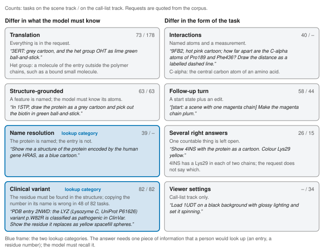

<!-- Built by paper/build.py from paper/sections/ and paper/generated/*.json (run numbers: October 2026 panel, PRELIMINARY). Do not edit: edit the sources. -->

# MolBench: grading language models on what a molecular viewer would show

⟦PENDING: Dan — author list, affiliations, corresponding author⟧

*Draft for review. Every number in this paper is written by a script from the task files, the
frozen data or archived model outputs; none is typed by hand. A cell or sentence marked
PENDING in double brackets waits for the one paid model run or for an author decision. Results that exist
today come from a pilot run in October 2026 and appear only in the boxed Section 6.6.*

## Abstract

Scientists now ask language models to drive molecular viewers in plain words: "show the residue
changed by this variant". A wrong picture looks as polished as a right one. MolBench grades a model on what the viewer
would draw: which atoms, in which representation and colour. Every reference answer is
computed by script from the deposited structure, a residue-level mapping to UniProt, and ClinVar,
and is checked against the structure. The corpus has 781 tasks on
75 structures in eight tiers, from fully specified requests to clinical
variants that must be mapped from UniProt numbering to the residues of a structure.
255 requests are posed in two output formats, a declarative scene and an
imperative call list, to separate not knowing the answer from not being able to write it. On
1,880 control answers with known verdicts the grader made no error; the two graders it
replaces failed 38% and
48% of the correct ones. In a pilot run, clinical tasks
scored lowest although most answers drew the right residue: they lost points on context that
nobody had requested. References now hold only what the request states.
⟦PENDING: final run — headline results on both tracks and the paired comparison, two sentences⟧
Tasks, graders and model outputs are open.

## 1. Introduction

Molecular viewers are how structural biologists look at their data, and they are hard to
drive. To show one residue of one chain, a user must know the viewer's selection language, the
chain identifier, and which of several residue numbering schemes applies. Language models
promise to remove that barrier: the user says what they want, and the model writes the
commands. Several viewers now ship such assistants, or can be operated by one through a tool
protocol [1, 2, 3, 4].

Whether these assistants are right is rarely measured, and a wrong answer is hard to see. One
request, which we follow through this paper, shows why:

> *"PDB entry 2NWD: the LYZ (Lysozyme C) variant F75I is
> classified as pathogenic in ClinVar. Show the residue it replaces as
> green ball-and-stick."*

The variant name F75I counts residues along the UniProt sequence of human lysozyme:
phenylalanine 75. The Protein Data Bank (PDB) entry 2NWD numbers
the same chain from the start of the mature protein, 18 residues later. In the file,
that phenylalanine is residue 57, and residue 75 is an
asparagine. A model that selects residue 75 returns a clean picture of the
wrong amino acid, and nothing in the picture says so. The case is not unusual: a survey of the
PDB found that 38.6% of 176,507 entries contain proteins that are not numbered as their
UniProt sequences are [5].

**Thesis.** Control of a molecular viewer by a language model can be measured exactly, and
without a second model as judge, if two conditions hold: each reference answer is computed
from the structure itself, and each answer is graded on what the viewer would draw, not on how
the answer is written.

MolBench is built on that thesis (Figure 1). The reference for the request above is not
written by a person. A script reads the variant from ClinVar [6], maps its
UniProt position [7] to the residues of the entry with the SIFTS mapping
[8], and confirms that the structure holds a phenylalanine there. The grader then
resolves any answer to the atoms it would draw in that structure, with their representation
and colour, and compares this *drawn state* with that of the reference. Two answers that name
the same atoms in different ways receive the same score.

This paper makes four contributions, presented in this order.

1. **A corpus built by script** (Section 3): 781 tasks on
   75 structures in eight tiers of difficulty, including
   79 clinical-variant requests on 27 proteins, of which
   57 need a change of residue number. Every reference records how it was made
   and is tested against the structure.
2. **A grader on drawn state, with a measured error rate** (Section 4): three scores with
   plain definitions, and a control set of 1,880 answers whose verdict is known from
   how they were made.
3. **A paired design** (Sections 3.4 and 5): 255 requests are posed in two
   output formats with the same target atoms, so that an error of content can be told apart
   from an error of format.
4. **Evidence** (Section 6): a pilot run on 15 models that exposed a flaw in
   our own references and changed the design (Sections 6.6 and 7), and the tables that one
   final run will fill. ⟦PENDING: final run — one sentence stating the main result⟧

We write "computational intelligence (CI)" for what is often called artificial intelligence.
Box 1 defines the terms used throughout.

**Box 1. Terms and notation.**

| Term | Meaning in this paper |
|:---|:---|
| Structure, entry | One deposited model from the Protein Data Bank (four-character identifier, such as 2NWD) or one predicted model from the AlphaFold Protein Structure Database. |
| Author numbering | The chain identifiers and residue numbers chosen by the depositors. This is what papers and most viewers show. |
| Label numbering | The chain identifiers and residue numbers assigned by the archive: residues are counted 1, 2, 3 … along each chain. |
| UniProt numbering | The position of a residue in the UniProt reference sequence of the protein. Variant names such as F75I use it. |
| SIFTS | Structure Integration with Function, Taxonomy and Sequences: the public residue-by-residue mapping between PDB entries and UniProt sequences. |
| Request | The plain-language instruction given to the model. |
| Scene | An answer in MolViewSpec: a description, in JSON (JavaScript Object Notation), of what to load and how to draw it. |
| Call list | An answer as an ordered list of calls to the PDBe Mol\* viewer (PDBe: Protein Data Bank in Europe). |
| Track | One of the two answer formats. *Scene track*: MolViewSpec scenes. *Call-list track*: viewer calls. |
| Draw | One representation type with one colour and one opacity, for example "grey cartoon, opaque". |
| Drawn state (final state) | For every atom of the structure, the set of its draws, plus a few facts about the whole scene (labels, distance lines, camera target). |
| Fact | One unit of the drawn state: all atoms that are drawn in the same way form one fact; each label or distance line is one fact. |
| F1 | How much of the drawn state is right, from 0 to 1: the harmonic mean of *recall* (the share of the reference's facts that the answer has) and *precision* (the share of the answer's facts that the reference has). |
| Task success | Yes or no: the drawn state is exactly right, with nothing missing and nothing extra. |
| Target score | From 0 to 1: are the atoms that the request is about drawn as asked, whatever else the answer did? |
| Valid output | An answer that parses as JSON and that the viewer accepts. |
| Strict / valid-only | Two ways to average a score. *Strict*: every output counts, an invalid one as 0. *Valid-only*: the mean over valid outputs. |
| Pair | One request posed on both tracks, with the same target atoms. |
| Held-back split | Tasks on structures that appear in no published task. |
| CI | Computational intelligence. |

## 2. Related work

We checked every work below against its source (the record of each check is in the
repository). Where we say that a benchmark lacks something, we mean that we did not find it in
the paper. We do not claim to be first or only.

### 2.1 Benchmarks that score control of scientific software

**ScienceBoard** [9] is the closest published benchmark. It has 169 tasks in
six domains, performed by agents that operate a desktop through screenshots and clicks. Its
biochemistry domain uses UCSF ChimeraX [10], and a task is checked by reading
the state of the application after the agent has finished. MolBench shares the idea of checking
the resulting state. It differs in four ways. It tests the step from request to commands
directly, with no desktop in between. Its references are computed by script and record their
origin. Its difficulty rises in defined steps, up to clinical variants. And it poses requests
in two answer formats.

**SciVisAgentBench** [11] has 108 expert-written cases of scientific
visualization; its molecular cases use GROMACS and VMD. Outcomes are scored by a language-model
judge against written rubrics, with deterministic checks for some suites. The authors compared
the judge with 12 visualization experts and report an agreement among raters (Krippendorff's
alpha) of 0.669 and a correlation between judge and human scores of about 0.81. MolBench is
narrower and stricter: it covers only molecular viewers, and its scores need no judge model.

**OSWorld-Science** [12] follows the OSWorld desktop benchmark
[13] with 146 tasks over scientific applications, one of which pairs PyMOL with a
nuclear magnetic resonance package. Evaluators inspect application state and output files and
give partial credit. The overlap with MolBench is small: a molecular viewer is one application
among many, and the tasks test the operation of a graphical interface.

General benchmarks of tool use, such as ToolLLM [14] and tau-bench
[15], measure whether a model calls the right function with the right arguments.
Our call-list track has that shape. The difference is the check: a viewer call is right only
if its selection resolves to the right atoms in a particular structure.

### 2.2 Assistants for molecular viewers

**Speak to a Protein** [3] is an assistant that answers questions about a
protein while driving a browser viewer built on the Mol\* engine [16]. Its
evaluation covers question answering; the paper lists viewer operations as a task group and
reports no accuracy for them. **ChatMol Copilot** [4] is an agent for molecular
modelling that includes control of PyMOL. **ChimeraX** can be operated from a chat assistant
through a built-in tool server; its documentation notes that the assistant "will often make
mistakes" [1]. **VOICE** [17] and a speech interface for an immersive
molecular-graphics application [18] control molecular scenes by spoken language
and were evaluated with users, not with scored tasks. The Mol\* project has merged an optional
assistant and a command layer into its next viewer [2]; we found no published
benchmark from that work. A community tool that builds MolViewSpec scenes from chat
[19] states in its documentation that the residue numbers researchers take from
ClinVar, publications and mutation databases "are always author numbers". That holds for some
entries and fails for many [5]. It is the error our clinical tier is built to
detect.

### 2.3 The data and software MolBench stands on

MolViewSpec describes a molecular scene as a tree of typed nodes and is implemented as an
extension of the Mol\* viewer [16, 20, 21]. The
call-list track targets the PDBe build of Mol\* [22], which a notebook widget exposes
to Python [23]. Structures come from the Protein Data Bank [24] and, for two
predicted models, from the AlphaFold Protein Structure Database [25, 26]. The mapping between UniProt residues and the residues of a structure
comes from SIFTS [8], as distributed by PDBe [27, 28]. Variants
and their clinical classification come from ClinVar [6], found through UniProt
[7]. Structure files are read with GEMMI [29].

The numbering problem at the centre of the clinical tier has been met from another side.
Vollmar and colleagues find residue mentions in the crystallographic literature and map them to
structures through SIFTS [30]. Their system reads papers; ours asks whether a
model can do the same mapping when it draws a scene. MiSI-Bench [31] asks
vision-language models questions about rendered images of molecules and finds them well below
human level, which is one reason our scores do not rest on a model that looks at pictures.

## 3. Building the benchmark

A task is a request, a reference answer, the atoms the request is about (the *target*), and a
record of how the reference was made. No reference is written by hand. This section follows
the running example from public data to a finished task, and then describes the corpus as a
whole.

### 3.1 Frozen public data

**Structures.** All tasks use a fixed panel of 76 structures: 74 PDB
entries [24] and 2 predicted models from the AlphaFold Protein
Structure Database [25]. The panel was chosen for coverage, not at random: small
and large folds, protein–ligand complexes, haem and metal sites, disulfide-rich proteins,
nucleic acids, glycans, membrane proteins, and biological assemblies that differ from the
deposited model. 68 entries were solved by X-ray crystallography,
4 by cryo-electron microscopy and 2 by nuclear magnetic
resonance. Every feature we claim for an entry is verified in its file by the build script, or
the build fails. In 46 structures at least one residue has an author number
that differs from its UniProt number. Entries are limited to 15,000 atoms so that
they render quickly (2 larger entries are kept from earlier tasks).
The Supporting Information (SI, Section S3) lists the panel and its selection rule.

**Disease proteins and variants.** 27 human disease proteins are
listed by UniProt accession, and one structure per protein is chosen by a scripted rule
(coverage of variant positions, then resolution; SI Section S3). Whether a structure is
numbered differently from UniProt played no part in the choice. For each protein we took every
single-residue missense variant that UniProt reports as pathogenic or likely pathogenic with
ClinVar as a source: 3,352 candidates. We then asked ClinVar itself.
UniProt lists a variant as pathogenic when any one submission to ClinVar says so, whereas
ClinVar's own classification aggregates all submitters. We kept a candidate only if its ClinVar
variant record names the same protein change and carries the aggregate classification
"Pathogenic", "Likely pathogenic" or "Pathogenic/Likely pathogenic". This removed
657 candidates (20%), most of them
classified as conflicting or of uncertain significance, and left 2,695.
ClinVar was read on 2026-11-12.

**Atom tables and residue mapping.** For each structure we store two frozen tables. The *atom
table* lists every atom with its chain and residue in both author and label numbering; it is
built from the deposited file and compared with what the viewer itself selects (Section 3.7).
The *mapping table* holds the SIFTS correspondence between each observed residue and its
UniProt position. Generators and graders read only these tables. Nothing is fetched while a
task is built from the tables, graded or loaded.

### 3.2 From data to a task: the running example

The clinical generator produced the running example in six steps.

1. **Variant.** From the confirmed list it draws LYZ F75I (UniProt
   P61626, p.Phe75Ile; ClinVar record VCV000014377, "Amyloidosis, hereditary systemic 5",
   classified pathogenic). The record's review status is
   "no assertion criteria provided"; we return to what that means in Section 9.
2. **Structure.** The panel structure for P61626 is 2NWD, human lysozyme at
   1.04 Å resolution.
3. **Mapping.** The mapping table says that UniProt positions
   19–148 are author residues
   1–130 of author chain X. Position 75 is therefore author
   residue 57 (label chain A, label residue
   57).
4. **Identity check.** The atom table must hold the wild-type amino acid at that residue. It
   does: Phe57, 20 atoms. Had the structure
   carried an engineered substitution there, the variant would not be offered for this entry.
5. **Wording.** A seeded random choice picks one of the template's three wordings, the colour
   (green) and the representation (ball-and-stick). The request names the structure and the
   variant. It never says which residue of the structure is meant.
6. **Reference, twice.** The script writes the reference scene (author chain
   X, author residue 57, green ball-and-stick) and the
   reference call list (load the entry; draw UniProt P61626 position
   75 as green ball-and-stick). It then confirms that both resolve to
   the same 20 atoms, and stores them as the target of both tasks.

The reference holds only what the request states: one residue, one representation, one colour.
It has no cartoon of the protein behind the residue, because the request does not ask for one.
Section 6.6 shows why this rule exists. SI Section S1 gives both tasks in full.

### 3.3 Eight tiers

Tasks are grouped into eight tiers by what a model must know beyond the request (Figure 2,
Table 1). Each tier has several *templates*: a template fixes what is asked, and a seeded
generator fills in the structure, the residues, the colours and the wording.
The corpus has 127 templates; outside two small tiers no template supplies
more than 12% of a tier's tasks. SI Section S2 lists every
template with an example.

- **Translation.** Everything needed is in the request: the entry, the chains, the residue
  numbers, the colours. The model only has to write it in the format.
- **Structure-grounded.** The request names a feature, such as the ligand, the disulfide bonds
  or the residues that hold a metal ion. Its atoms must be known from the structure. References
  are read from the entry's own records.
- **Interactions.** The request names atoms and a measurement between them, such as a hydrogen
  bond drawn as a labelled line.
- **Name resolution.** The request names a protein, not an entry ("a structure of human p53
  bound to DNA"). Any entry on a frozen list of matching entries is accepted, and the drawing
  is compared on the entry the model chose.
- **Clinical variant.** As in the running example. Of the 79 tasks per track,
  57 (72%) have a target whose author number differs from
  its UniProt number, by 1 to 216 residues, and in
  23 the author chain identifier differs from the label chain identifier.
  14 requests use a traditional name counted along the mature protein
  (the form found in older literature, such as transthyretin V30M) and say so. An answer that takes
  the number in the variant name as the author residue number is right in
  34 tasks and wrong in 45; results are
  reported for the two groups apart. 14 tasks ask the same variant on two
  structures of one protein, and 10 also ask for the helix or strand around the
  residue.
- **Follow-up turn.** The model receives a start state and an edit request ("make the magenta
  chain plum") and returns the complete new state. Only the final state is graded, so an answer
  that loses an earlier choice fails. In 10 scene tasks and
  8 call-list tasks the right answer is to change nothing.
- **Several right answers.** The request leaves one countable thing open. "Colour Lys29
  yellow" in an insulin entry with two B chains can mean either copy or both. The script lists
  every accepted final state (a median of 3 readings per
  task), and an answer that matches any of them is right.
- **Viewer settings.** Settings that only the call-list format can express, such as electron
  density maps, background and spin.

**Table 1. The corpus.** Tasks per tier and track, written as total (public + held back; Section
3.6). *Pairs*: requests posed on both tracks with the same target atoms. A dash means that the
format cannot express the tier.

| Tier | What is asked | Scene track (public + held back) | Call-list track (public + held back) | Pairs |
|:---|:---|---:|---:|---:|
| Translation | Everything needed is in the request; write it in the format. | 68 (51 + 17) | 163 (127 + 36) | 57 |
| Structure-grounded | The request names a feature (the ligand, the disulfides); its atoms must be found in the structure. | 68 (56 + 12) | 68 (56 + 12) | 68 |
| Interactions | Named atoms and a measurement or contact between them. | 40 (32 + 8) | – | – |
| Name resolution | The structure is named by protein, not by identifier. | 39 (32 + 7) | – | – |
| Clinical variant | A variant in UniProt numbering must be mapped to the residues of the structure. | 79 (59 + 20) | 79 (59 + 20) | 79 |
| Follow-up turn | A start state plus an edit request; the full new state is returned. | 58 (47 + 11) | 44 (34 + 10) | 36 |
| Several right answers | The request leaves one countable thing open; several final states are right. | 26 (21 + 5) | 15 (11 + 4) | 15 |
| Viewer settings | A viewer setting that only the call-list format can express. | – | 34 (29 + 5) | – |
| **All** | | **378** (298 + 80) | **403** (316 + 87) | **255** |

The 781 tasks (378 scene, 403 call-list) use
75 of the 76 panel structures. The one unused entry is the worked
example in the call-list prompt, which must not also be a task. No structure appears in more
than 6 tasks of one tier and track.

### 3.4 The same request in two formats

A wrong answer has two possible causes: the model did not know which atoms were meant, or it
knew and could not write them in the format. One format cannot separate the two. MolBench
therefore poses 255 requests (67% of the scene
tasks) on both tracks, with identical wording and the same target atoms (Figure 3).

The two formats differ in kind. A MolViewSpec scene [20] is *declarative*: a tree
that states what to load, which atoms form a component, and how each component is drawn.
Nothing is on screen unless the scene says so. A call list is *imperative*: an ordered list of
calls to the PDBe Mol\* viewer, version 3.3.2 [22]. The viewer starts with the whole
structure drawn in a default style, and each call changes that state, so order matters.

The formats also differ in what they demand for a clinical request, and we state this openly
because it shapes the comparison. The viewer behind the call-list track can select a residue by
UniProt accession and position and does the mapping itself. A scene has no such selector: the
model must produce author or label numbers. The running example's call-list reference uses the
UniProt selector; its scene reference uses author residue 57. Either numbering
is accepted on either track if it resolves to the right atoms.

Pairs exist in five tiers: translation (57), structure-grounded
(68), clinical (79), follow-up
(36) and several right answers (15).
123 scene tasks have no partner, because the call-list format cannot
draw a distance line, a text label or a transparent surface, or cannot be graded on an entry
outside the panel. 18 call-list partners need an extra step that
the request does not state: switching off parts of the viewer's default drawing. The paired
analysis is reported with and without them.

### 3.5 What a request may leave open

Requests written by people leave things unsaid, and a benchmark must decide what silence
means. We use one rule: **an attribute that the request does not state is free; one that it
states must match.** If the request gives no colour for a ligand, any colour is accepted, by
listing the alternatives in the task or by a rule of the grader. If it says "green", only green
is right. The same holds for the representation. Context works the other way round, because
context is drawing: an answer that adds a cartoon nobody asked for has drawn something
unrequested, and loses precision and task success (Section 4.2), while its target score is
unaffected.

### 3.6 Public and held-back tasks; wording

MolBench tasks have been public since May 2026, so a model released later may have seen
earlier tasks. Two measures address this. First, generators are seeded, and
15 structures were set aside before generation. The
167 tasks on them (21% of the corpus) form a
*held-back split*: no public task uses those structures, and the split is not published before
the final run. Results are reported for both splits and compared. Second, to measure
sensitivity to wording, 30 requests of the public split have two
further phrasings each, a terse one and an indirect one, with the same reference
(88 additional task files, not counted in Table 1).

### 3.7 Checks on the corpus

Four checks involve no model (Figure 1, bottom row).

- **Reference against structure.** Every reference must select at least one atom, must name the
  residue that the generator intended, and must grade as exactly right against itself. Every
  accepted alternative must do the same.
- **Atom tables against the viewer.** Selections were read back from the real viewers. For the
  scene track, Mol\* 5.9.0 was run without a display and asked which atoms each representation
  holds. For the call-list track, call lists were replayed in PDBe Mol\* 3.3.2 and each
  selection compared atom for atom (234 lists, all in agreement). A
  bare load of 73 panel entries was compared in the same way.
- **Grader against a control set.** Section 4.5.
- **Format rules.** One script validates every task file against the written task format and
  refuses a corpus in which any check fails. The run refuses to start on such a corpus.

## 4. Grading on drawn state

### 4.1 From an answer to a drawn state

An answer is graded by what the viewer would show, not by how the answer is written. The
grader turns the reference and the answer into a *drawn state*: for every atom of the
structure, the set of its *draws* (a representation type with a colour and an opacity), plus a
few facts about the scene as a whole. It does so with the frozen atom tables and with the rules
of the viewer itself, which we read back from the running viewer and did not take from
documentation. Two examples of such rules: a cartoon draws only polymer residues, so a cartoon
of "everything" and a cartoon of "the polymer" are the same drawing; and a cartoon requested
for a ligand is drawn by Mol\* as ball-and-stick, and is graded as that. No browser runs and
nothing is fetched while grading.

The drawn state is cut into *facts* of equal weight. All atoms that carry the same set of
draws form one fact. "The protein as a grey cartoon, with one residue also as red
ball-and-stick" is two facts: the atoms of that residue (grey cartoon and red ball-and-stick),
and all other protein atoms (grey cartoon only). Each text label, each distance line and the
camera target, when the request asks for one, is a further fact. Loading the right entry earns
nothing by itself; on the wrong entry nothing can be compared and every score is 0.

On the call-list track the grader replays the calls in order, following the behaviour of PDBe
Mol\* 3.3.2, and compares the end state. Because that viewer draws the whole structure as soon
as it loads, the facts of a call-list answer are its *differences from a bare load*. Order
matters, as it does in the viewer: a later call can undo an earlier one, and the answer is
graded on where it ends. SI Section S4 lists every rule on both tracks.

### 4.2 Three scores

Each answer receives three scores. They answer different questions, and Section 4.3 shows them
parting on the running example.

**F1: how much of the drawn state is right?** *Recall* is the mean, over the reference's
facts, of how much of each fact the answer has. *Precision* is the mean, over the answer's
facts, of how much of each the reference has. F1 is their harmonic mean, from 0 to 1. For a
group of atoms, "how much" is the share of their draws that the other side also has; a draw
with the right representation and the wrong colour counts half. Missing drawing therefore
costs recall, and unrequested drawing costs precision.

**Task success: is the drawn state exactly right?** Yes if recall and precision are both 1 on
the right structure: every fact of the reference is present and the answer has no other. For a
model on a task, task success is the share of its sampled answers that are exactly right. This
is the headline score, because a viewer scene is either the one that was asked for or it is
not.

**Target score: are the requested atoms right, whatever else was drawn?** Each task stores
the atoms the request is about. The target score, from 0 to 1, compares only how those atoms
are drawn: it gives credit for each requested draw that the answer has (half credit for the
wrong colour), and takes credit away when the answer applies the same drawing to atoms outside
the target (colouring the whole chain when one residue was asked for) or wraps the target in a
representation that was not requested. Context that merely passes through the target, such as
a cartoon of the whole chain, is ignored. The target score separates "found the wrong residue"
from "found the right residue and added scenery".

When a task lists several accepted answers (Section 3.3), an answer is graded against each,
and the best result counts. The two tracks share these definitions; the arithmetic of F1
differs slightly between them (SI Section S4), and task success means the same on both.

### 4.3 The running example, graded

Figure 4 and Table 2 grade several answers to the running example. The reference draws
Phe57 of chain X as green ball-and-stick, and
nothing else.

**Table 2. Answers to the running example and their scores**, computed by the benchmark's
grader. *F1*: how much of the drawn state is right (0 to 1). *Task success*: the drawn state
is exactly right. *Target score*: the requested atoms are drawn as asked, whatever else was
drawn (0 to 1).

| Answer | F1 | Task success | Target score |
|:---|---:|:---|---:|
| **Scene track** | | | |
| Reference: author chain X, author residue 57, green ball-and-stick | 1.00 | yes | 1.00 |
| The same residue named by label numbering (label chain A, residue 57) | 1.00 | yes | 1.00 |
| Number in the variant name used as the author number (Asn75) | 0.00 | no | 0.00 |
| Right residue, drawn red | 0.50 | no | 0.50 |
| Right residue, plus a grey cartoon of the protein that the request does not ask for | 0.40 | no | 1.00 |
| Wrong residue, plus the grey cartoon | 0.00 | no | 0.00 |
| **Call-list track** | | | |
| Reference: UniProt P61626 position 75, resolved by the viewer | 1.00 | yes | 1.00 |
| The same residue named by author numbering (chain X, residue 57) | 1.00 | yes | 1.00 |
| Number in the variant name used as the author number (Asn75) | 0.00 | no | 0.00 |
| Right residue, drawn red | 0.50 | no | 0.50 |
| Load only, no further call | 0.00 | no | 0.00 |

Three points follow. First, an answer may name the residue in any numbering: the second row of
each track is written differently from the reference and scores the same, because it draws the
same atoms. Second, the answer that takes "75" at face value draws
Asn75, shares no atom with the reference, and scores
0 on all three measures. Third, the answer that finds the right residue and adds a grey
cartoon of the protein has a target score of 1.00 but an F1 of
0.40 and no task success: it drew a cartoon over the whole chain that the
request did not mention. F1 alone cannot tell this answer from one that found the
wrong residue against a correct background; the target score can.

### 4.4 Invalid output

Some answers cannot be shown at all. Every sampled answer gets one *outcome*. On the scene
track an answer is *valid* if it parses as JSON, is a scene tree, and passes the validation of
Mol\* 5.9.0 itself, run without a display. On the call-list track an answer is valid if it
parses as a JSON list that fits the call schema. An answer with an unknown call or a wrongly
typed field is counted as not valid, but it is still replayed as the viewer would treat it and
graded on the state it reaches. An answer cut off at the token limit is counted apart from a
malformed one.

Scores are averaged in three named ways.

- **Strict** (primary): every answer counts, and an answer that cannot be shown scores 0 on
  all three scores. This is what a user of the bare model would experience.
- **Valid-only**: the mean over valid answers. This separates "wrote a loadable answer" from
  "the answer is right".
- **Repaired**: a counterfactual. Each reply that is not parseable JSON is passed through an
  offline JSON repair library [32] and graded again. No model is called. The repaired
  score is reported beside the strict score and never replaces it.

### 4.5 How well the grader itself works

A grader that compares drawn states can still be wrong: it may fail a correct answer that is
written in an unexpected way, or pass a wrong one. We measured this with a *control set* of
1,880 pairs of a reference and an answer whose verdict is known from how the pair
was made (Table 3). The answer is one of three things.

- **Identical**: the reference itself. It must pass.
- **Equivalent**: the reference rewritten so that the viewer shows the same. Examples: a
  residue range as a list of residues; label numbering in place of author numbering where the
  two name the same atoms; a colour as a hexadecimal code; one component or several; on the
  call-list track, a wrong step that a later step undoes. It must pass.
- **Wrong**: an answer that shows something else. Examples: the neighbouring residue; the other
  chain; the UniProt number used as the author number on a structure where they differ; a
  nearby shade of the colour; a missing or an extra component; another copy of the ligand. It
  must fail.

A *false pass* is a wrong answer graded as a task success. A *false fail* is an identical or
equivalent answer graded as not a success.

**Table 3. Error rate of the grader on the control set.** *False pass*: wrong answers graded as
task success, out of all wrong answers. *False fail*: identical or equivalent answers graded as
not a success, out of all such answers. *Earlier grader*: the grader that this work replaces on
each track (for the scene track, a comparison of scene trees path by path; for the call-list
track, a comparison of call sequences field by field), with a score of exactly 1 read as
success.

| Track | Controls | Structures | Kinds of equivalent / wrong answer | False pass | False fail | Earlier grader: false pass | Earlier grader: false fail |
|:---|---:|---:|---:|---:|---:|---:|---:|
| Scene | 1,030 | 75 | 22 / 22 | 0 of 440 | 0 of 590 | 0 of 440 | 222 of 590 (38%) |
| Call list | 850 | 69 | 18 / 17 | 0 of 340 | 0 of 510 | 75 of 340 (22%) | 247 of 510 (48%) |

The zeros must be read with care. We corrected the grader until it agreed with every control,
so they show that the stated rules are implemented. They do not show how often a way of
writing an answer that we did not foresee is misjudged. Two things keep the control set
honest. First, the verdicts do not come from the grader. For the scene track, both scenes of a
pair were loaded in Mol\* 5.9.0 and the atoms, colours and opacities of each representation
were read back: the viewer drew the same for the must-pass pairs and something different for
the must-fail pairs in all 890 pairs that can be read back this way
(140 pairs of kinds such as camera target and label text cannot).
For the call-list track, 234 call lists were replayed in PDBe Mol\*
3.3.2 and the end state matched the grader's replay in every case. Second, the earlier graders
give the scale of the problem that the control set detects: the scene grader used in our pilot
run failed 38% of correct answers, and the first call-list
grader passed 22% of wrong ones. SI Section S5 lists every
kind of control with its counts.

### 4.6 What is deliberately not graded

Camera position is never graded. If the request asks to focus on something, the grader compares
which residues the camera frames; if it does not, a focus in the answer is not counted. Sizes,
line widths and label styling are not graded. Two colours are the same if every channel (0 to
255) differs by at most 32. Requests use a palette of 19
named colours whose closest pair (plum and hotpink) is 55
apart, so no palette colour can pass for another, and a lighter or darker named shade is a
different colour. In the pilot run, 2,227 of 2,303
comparable colour values were exactly the requested colour, and none of the other
76 came closer than 58.

## 5. Experimental setup

One run fills every result in Section 6. Its plan is fixed in a single manifest file before any
model is called: the corpus version and its hash, the models and their prices, the prompting
conditions, the number of samples and the limits. SI Section S6 reproduces it.

### 5.1 Models

The panel is set by a written rule, not by results. It has 16 language
models (13 with openly available weights, 3 without):
every model on the project's public leaderboard of October 2026, so that old and new numbers
can be compared. Up to 5 further models, the largest current model of
each major provider on the price date, are optional entries marked † in the tables. No model is
added or dropped after results are seen. A *keyword script* that uses no model is run on both
tracks as a floor: it maps words in the request to fixed output by rule.

### 5.2 Prompting conditions

Every model receives a system prompt and the request, and returns one answer. Models cannot
look anything up, ask a question back, or see a rendered result.

**Table 4. Prompting conditions.** *Format reference*: a frozen text that documents the answer
format. *JSON mode*: a provider option that forces syntactically valid JSON. *Grounding pack*:
facts about the structure that an offline lookup could produce.

| Condition | What the model is given | Run on |
|:---|:---|:---|
| **Format reference** (headline) | A short instruction, the output rule ("answer with one JSON value and nothing else") and a frozen reference text for the answer format | all models, all tasks, both tracks |
| Format reference + JSON mode | The same, with the provider's option that forces syntactically valid JSON | models that offer it; 1 sample |
| Format reference + grounding pack | The same, with a *grounding pack* appended to the request: facts about the structure that an offline lookup could produce (chains, residue ranges in both numberings, the UniProt mapping) | name-resolution and clinical tiers, scene track |
| No format reference | The instruction and the output rule only | 3 models, scene track |

A grounding pack never contains a scene, a colour or a representation. For the running example
it states that UniProt 19–148 are author residues
1–130 of chain X (SI Section S1). No prompt was tuned on benchmark tasks, and the worked example in the call-list prompt
uses a structure that no task uses. SI Section S7 gives both system prompts.

### 5.3 Sampling

Each model answers each task 3 times in the headline condition, at the
provider's default temperature. The output limit is 8,000 tokens. A malformed
answer is scored as it stands and is not retried; only transport errors are retried. Every raw
answer is archived with its token counts, finish reason and cost.

### 5.4 Statistics

- **Per-model scores** are means over tasks of the mean over samples. Task success is also
  reported as the share of tasks on which all 3 samples are right.
- **Intervals** are 95% bootstrap intervals [33] with 10,000
  resamples. Whole structures are resampled, not single tasks, because tasks on one structure
  share its difficulties.
- **Paired comparison of formats.** For each model and pair, a side counts as right when at
  least two of its three samples are exactly right. Pairs right on one side only are compared
  with McNemar's exact test [34]. We report the four counts for every model, and
  repeat the analysis without the 18 pairs that need an unstated
  hide step and without the clinical pairs, where the call-list viewer can do the mapping
  itself (Section 3.4).
- **Planned comparisons**, each as a difference in task success with an interval: public
  against held-back split; full against terse and indirect wording; with and without JSON
  mode; with and without grounding pack; clinical tasks in which the number in the variant name
  is, or is not, the author residue number.

We do not correct for multiple comparisons; the comparisons are few, stated here in advance,
and reported in full.

### 5.5 Human check of the grader

The grader's verdict is also checked against people. After the run, volunteers will see pairs
of pictures, a reference and a model answer rendered from the same camera and framed on the
target atoms, and say whether the two show the same thing. The design calls for
300 pairs with 2 raters each. People's answers are compared
with the grader's task success. A further 40 pairs are answers that the
grader counts as exactly right although their pictures are not identical pixel for pixel;
people should call these the same. The study also tests an *image judge*: a vision-language
model that is shown the same two pictures and asked the same question. The image judge
contributes to no score in this paper. A smaller pilot of the study has been run (Section 6.6).

### 5.6 Reproducibility

One command performs the run from the manifest and stops if the projected cost passes a stated
cap. One command rebuilds every table, figure and number in this paper from the archived
answers. A rehearsal with a mock model exercises the whole path at no cost. Grading needs no
network access and no paid service.

## 6. Results

Sections 6.1 to 6.5 show every result table in its final shape. The cells wait for the one
paid run and are filled by script from its archive; the layout, the captions and the
definitions will not change. Section 6.6 is different: it reports, in a box, what a pilot run
in October 2026 showed. Those numbers are real but come from an older corpus, and they are
kept apart from everything else.

![**Figure 5. The result figures that the final run will fill.** No data are shown. **A**: task success per model on both tracks, with 95% intervals; *task success* is the share of answers whose drawn state is exactly right, with an invalid answer counted as wrong (strict). **B**: for each model, its pairs split by which side was right. **C**: task success and target score per tier over valid outputs; *target score* asks only whether the requested atoms are drawn as asked, so a gap between the two marks is unrequested extra drawing.](generated/fig_result_shapes.svg)

### 6.1 Models on both tracks

**Table 5. Scene track, headline condition (format reference).** One row per model; † marks an
optional model. *Valid outputs*: share of answers that parse and that the viewer accepts. *F1*:
how much of the drawn state is right (0 to 1). *Task success*: share of answers whose drawn
state is exactly right. *Target score*: whether the requested atoms are drawn as asked,
whatever else was drawn (0 to 1). *Strict*: an invalid answer counts as 0. *Valid outputs
only*: the mean over valid answers. *All 3 samples right*: share of tasks on which every
sampled answer is exactly right. *Cost*: US dollars for all calls of the model in this
condition, at list price. Intervals (95%, structures resampled) will be given with each score.

| Model | Weights | Valid outputs | F1 (strict) | Task success (strict) | Target score (strict) | F1, valid outputs only | Tasks with all 3 samples right | Cost (USD) |
|:---|:---|---:|---:|---:|---:|---:|---:|---:|
| Keyword script (no model) | – | ⟦PENDING: final run⟧ | ⟦PENDING: final run⟧ | ⟦PENDING: final run⟧ | ⟦PENDING: final run⟧ | ⟦PENDING: final run⟧ | ⟦PENDING: final run⟧ | ⟦PENDING: final run⟧ |
| claude-haiku-4-5 | closed | ⟦PENDING: final run⟧ | ⟦PENDING: final run⟧ | ⟦PENDING: final run⟧ | ⟦PENDING: final run⟧ | ⟦PENDING: final run⟧ | ⟦PENDING: final run⟧ | ⟦PENDING: final run⟧ |
| deepseek-v3.2 | open | ⟦PENDING: final run⟧ | ⟦PENDING: final run⟧ | ⟦PENDING: final run⟧ | ⟦PENDING: final run⟧ | ⟦PENDING: final run⟧ | ⟦PENDING: final run⟧ | ⟦PENDING: final run⟧ |
| deepseek-v4-flash | open | ⟦PENDING: final run⟧ | ⟦PENDING: final run⟧ | ⟦PENDING: final run⟧ | ⟦PENDING: final run⟧ | ⟦PENDING: final run⟧ | ⟦PENDING: final run⟧ | ⟦PENDING: final run⟧ |
| gemini-3.5-flash | closed | ⟦PENDING: final run⟧ | ⟦PENDING: final run⟧ | ⟦PENDING: final run⟧ | ⟦PENDING: final run⟧ | ⟦PENDING: final run⟧ | ⟦PENDING: final run⟧ | ⟦PENDING: final run⟧ |
| gemma-3-27b-it | open | ⟦PENDING: final run⟧ | ⟦PENDING: final run⟧ | ⟦PENDING: final run⟧ | ⟦PENDING: final run⟧ | ⟦PENDING: final run⟧ | ⟦PENDING: final run⟧ | ⟦PENDING: final run⟧ |
| gpt-5.4-nano | closed | ⟦PENDING: final run⟧ | ⟦PENDING: final run⟧ | ⟦PENDING: final run⟧ | ⟦PENDING: final run⟧ | ⟦PENDING: final run⟧ | ⟦PENDING: final run⟧ | ⟦PENDING: final run⟧ |
| llama-4-maverick | open | ⟦PENDING: final run⟧ | ⟦PENDING: final run⟧ | ⟦PENDING: final run⟧ | ⟦PENDING: final run⟧ | ⟦PENDING: final run⟧ | ⟦PENDING: final run⟧ | ⟦PENDING: final run⟧ |
| minimax-m3 | open | ⟦PENDING: final run⟧ | ⟦PENDING: final run⟧ | ⟦PENDING: final run⟧ | ⟦PENDING: final run⟧ | ⟦PENDING: final run⟧ | ⟦PENDING: final run⟧ | ⟦PENDING: final run⟧ |
| mistral-small-2603 | open | ⟦PENDING: final run⟧ | ⟦PENDING: final run⟧ | ⟦PENDING: final run⟧ | ⟦PENDING: final run⟧ | ⟦PENDING: final run⟧ | ⟦PENDING: final run⟧ | ⟦PENDING: final run⟧ |
| kimi-k2.6 | open | ⟦PENDING: final run⟧ | ⟦PENDING: final run⟧ | ⟦PENDING: final run⟧ | ⟦PENDING: final run⟧ | ⟦PENDING: final run⟧ | ⟦PENDING: final run⟧ | ⟦PENDING: final run⟧ |
| nemotron-3-super-120b-a12b | open | ⟦PENDING: final run⟧ | ⟦PENDING: final run⟧ | ⟦PENDING: final run⟧ | ⟦PENDING: final run⟧ | ⟦PENDING: final run⟧ | ⟦PENDING: final run⟧ | ⟦PENDING: final run⟧ |
| gpt-oss-120b | open | ⟦PENDING: final run⟧ | ⟦PENDING: final run⟧ | ⟦PENDING: final run⟧ | ⟦PENDING: final run⟧ | ⟦PENDING: final run⟧ | ⟦PENDING: final run⟧ | ⟦PENDING: final run⟧ |
| gpt-oss-20b | open | ⟦PENDING: final run⟧ | ⟦PENDING: final run⟧ | ⟦PENDING: final run⟧ | ⟦PENDING: final run⟧ | ⟦PENDING: final run⟧ | ⟦PENDING: final run⟧ | ⟦PENDING: final run⟧ |
| qwen3-30b-a3b-instruct-2507 | open | ⟦PENDING: final run⟧ | ⟦PENDING: final run⟧ | ⟦PENDING: final run⟧ | ⟦PENDING: final run⟧ | ⟦PENDING: final run⟧ | ⟦PENDING: final run⟧ | ⟦PENDING: final run⟧ |
| qwen3-next-80b-a3b-instruct | open | ⟦PENDING: final run⟧ | ⟦PENDING: final run⟧ | ⟦PENDING: final run⟧ | ⟦PENDING: final run⟧ | ⟦PENDING: final run⟧ | ⟦PENDING: final run⟧ | ⟦PENDING: final run⟧ |
| glm-5.2 | open | ⟦PENDING: final run⟧ | ⟦PENDING: final run⟧ | ⟦PENDING: final run⟧ | ⟦PENDING: final run⟧ | ⟦PENDING: final run⟧ | ⟦PENDING: final run⟧ | ⟦PENDING: final run⟧ |
| claude-opus-5.5 † | closed | ⟦PENDING: final run⟧ | ⟦PENDING: final run⟧ | ⟦PENDING: final run⟧ | ⟦PENDING: final run⟧ | ⟦PENDING: final run⟧ | ⟦PENDING: final run⟧ | ⟦PENDING: final run⟧ |
| gpt-6.1-sol † | closed | ⟦PENDING: final run⟧ | ⟦PENDING: final run⟧ | ⟦PENDING: final run⟧ | ⟦PENDING: final run⟧ | ⟦PENDING: final run⟧ | ⟦PENDING: final run⟧ | ⟦PENDING: final run⟧ |
| gemini-4-argon † | closed | ⟦PENDING: final run⟧ | ⟦PENDING: final run⟧ | ⟦PENDING: final run⟧ | ⟦PENDING: final run⟧ | ⟦PENDING: final run⟧ | ⟦PENDING: final run⟧ | ⟦PENDING: final run⟧ |
| grok-4.7 † | closed | ⟦PENDING: final run⟧ | ⟦PENDING: final run⟧ | ⟦PENDING: final run⟧ | ⟦PENDING: final run⟧ | ⟦PENDING: final run⟧ | ⟦PENDING: final run⟧ | ⟦PENDING: final run⟧ |
| deepseek-v4-pro-0813 † | open | ⟦PENDING: final run⟧ | ⟦PENDING: final run⟧ | ⟦PENDING: final run⟧ | ⟦PENDING: final run⟧ | ⟦PENDING: final run⟧ | ⟦PENDING: final run⟧ | ⟦PENDING: final run⟧ |

**Table 6. Call-list track, headline condition.** Same columns and definitions as Table 5.

⟦PENDING: final run — the table for the call-list track, in the shape of Table 5⟧

### 6.2 Tiers

**Table 7. Scores by tier and track**, mean over models. *F1*, *task success* and *target
score* as in Table 5. *Strict*: an invalid answer counts as 0. *Valid outputs only*: the mean
over valid answers, which shows the difficulty of a tier once the format has been written
correctly.

| Tier | Tasks | Structures | F1 (strict) | Task success (strict) | Target score (strict) | Task success, valid outputs only |
|:---|---:|---:|---:|---:|---:|---:|
| Scene track: Translation | 68 | ⟦PENDING: final run⟧ | ⟦PENDING: final run⟧ | ⟦PENDING: final run⟧ | ⟦PENDING: final run⟧ | ⟦PENDING: final run⟧ |
| Scene track: Structure-grounded | 68 | ⟦PENDING: final run⟧ | ⟦PENDING: final run⟧ | ⟦PENDING: final run⟧ | ⟦PENDING: final run⟧ | ⟦PENDING: final run⟧ |
| Scene track: Interactions | 40 | ⟦PENDING: final run⟧ | ⟦PENDING: final run⟧ | ⟦PENDING: final run⟧ | ⟦PENDING: final run⟧ | ⟦PENDING: final run⟧ |
| Scene track: Name resolution | 39 | ⟦PENDING: final run⟧ | ⟦PENDING: final run⟧ | ⟦PENDING: final run⟧ | ⟦PENDING: final run⟧ | ⟦PENDING: final run⟧ |
| Scene track: Clinical variant | 79 | ⟦PENDING: final run⟧ | ⟦PENDING: final run⟧ | ⟦PENDING: final run⟧ | ⟦PENDING: final run⟧ | ⟦PENDING: final run⟧ |
| Scene track: Follow-up turn | 58 | ⟦PENDING: final run⟧ | ⟦PENDING: final run⟧ | ⟦PENDING: final run⟧ | ⟦PENDING: final run⟧ | ⟦PENDING: final run⟧ |
| Scene track: Several right answers | 26 | ⟦PENDING: final run⟧ | ⟦PENDING: final run⟧ | ⟦PENDING: final run⟧ | ⟦PENDING: final run⟧ | ⟦PENDING: final run⟧ |
| Call-list track: Translation | 163 | ⟦PENDING: final run⟧ | ⟦PENDING: final run⟧ | ⟦PENDING: final run⟧ | ⟦PENDING: final run⟧ | ⟦PENDING: final run⟧ |
| Call-list track: Structure-grounded | 68 | ⟦PENDING: final run⟧ | ⟦PENDING: final run⟧ | ⟦PENDING: final run⟧ | ⟦PENDING: final run⟧ | ⟦PENDING: final run⟧ |
| Call-list track: Clinical variant | 79 | ⟦PENDING: final run⟧ | ⟦PENDING: final run⟧ | ⟦PENDING: final run⟧ | ⟦PENDING: final run⟧ | ⟦PENDING: final run⟧ |
| Call-list track: Follow-up turn | 44 | ⟦PENDING: final run⟧ | ⟦PENDING: final run⟧ | ⟦PENDING: final run⟧ | ⟦PENDING: final run⟧ | ⟦PENDING: final run⟧ |
| Call-list track: Several right answers | 15 | ⟦PENDING: final run⟧ | ⟦PENDING: final run⟧ | ⟦PENDING: final run⟧ | ⟦PENDING: final run⟧ | ⟦PENDING: final run⟧ |
| Call-list track: Viewer settings | 34 | ⟦PENDING: final run⟧ | ⟦PENDING: final run⟧ | ⟦PENDING: final run⟧ | ⟦PENDING: final run⟧ | ⟦PENDING: final run⟧ |

### 6.3 The same request in two formats

**Table 8. Paired comparison of the two formats.** For each model, its
255 pairs (one request on both tracks, same target atoms) are split four
ways. A side is *right* when at least two of its three sampled answers are exactly right (task
success). *McNemar p*: exact test that the two one-sided counts are equal; a small value means
that one format is harder for this model. † marks an optional model.

| Model | Pairs | Both right | Scene right, call list wrong | Call list right, scene wrong | Both wrong | McNemar p |
|:---|---:|---:|---:|---:|---:|---:|
| claude-haiku-4-5 | 255 | ⟦PENDING: final run⟧ | ⟦PENDING: final run⟧ | ⟦PENDING: final run⟧ | ⟦PENDING: final run⟧ | ⟦PENDING: final run⟧ |
| deepseek-v3.2 | 255 | ⟦PENDING: final run⟧ | ⟦PENDING: final run⟧ | ⟦PENDING: final run⟧ | ⟦PENDING: final run⟧ | ⟦PENDING: final run⟧ |
| deepseek-v4-flash | 255 | ⟦PENDING: final run⟧ | ⟦PENDING: final run⟧ | ⟦PENDING: final run⟧ | ⟦PENDING: final run⟧ | ⟦PENDING: final run⟧ |
| gemini-3.5-flash | 255 | ⟦PENDING: final run⟧ | ⟦PENDING: final run⟧ | ⟦PENDING: final run⟧ | ⟦PENDING: final run⟧ | ⟦PENDING: final run⟧ |
| gemma-3-27b-it | 255 | ⟦PENDING: final run⟧ | ⟦PENDING: final run⟧ | ⟦PENDING: final run⟧ | ⟦PENDING: final run⟧ | ⟦PENDING: final run⟧ |
| gpt-5.4-nano | 255 | ⟦PENDING: final run⟧ | ⟦PENDING: final run⟧ | ⟦PENDING: final run⟧ | ⟦PENDING: final run⟧ | ⟦PENDING: final run⟧ |
| llama-4-maverick | 255 | ⟦PENDING: final run⟧ | ⟦PENDING: final run⟧ | ⟦PENDING: final run⟧ | ⟦PENDING: final run⟧ | ⟦PENDING: final run⟧ |
| minimax-m3 | 255 | ⟦PENDING: final run⟧ | ⟦PENDING: final run⟧ | ⟦PENDING: final run⟧ | ⟦PENDING: final run⟧ | ⟦PENDING: final run⟧ |
| mistral-small-2603 | 255 | ⟦PENDING: final run⟧ | ⟦PENDING: final run⟧ | ⟦PENDING: final run⟧ | ⟦PENDING: final run⟧ | ⟦PENDING: final run⟧ |
| kimi-k2.6 | 255 | ⟦PENDING: final run⟧ | ⟦PENDING: final run⟧ | ⟦PENDING: final run⟧ | ⟦PENDING: final run⟧ | ⟦PENDING: final run⟧ |
| nemotron-3-super-120b-a12b | 255 | ⟦PENDING: final run⟧ | ⟦PENDING: final run⟧ | ⟦PENDING: final run⟧ | ⟦PENDING: final run⟧ | ⟦PENDING: final run⟧ |
| gpt-oss-120b | 255 | ⟦PENDING: final run⟧ | ⟦PENDING: final run⟧ | ⟦PENDING: final run⟧ | ⟦PENDING: final run⟧ | ⟦PENDING: final run⟧ |
| gpt-oss-20b | 255 | ⟦PENDING: final run⟧ | ⟦PENDING: final run⟧ | ⟦PENDING: final run⟧ | ⟦PENDING: final run⟧ | ⟦PENDING: final run⟧ |
| qwen3-30b-a3b-instruct-2507 | 255 | ⟦PENDING: final run⟧ | ⟦PENDING: final run⟧ | ⟦PENDING: final run⟧ | ⟦PENDING: final run⟧ | ⟦PENDING: final run⟧ |
| qwen3-next-80b-a3b-instruct | 255 | ⟦PENDING: final run⟧ | ⟦PENDING: final run⟧ | ⟦PENDING: final run⟧ | ⟦PENDING: final run⟧ | ⟦PENDING: final run⟧ |
| glm-5.2 | 255 | ⟦PENDING: final run⟧ | ⟦PENDING: final run⟧ | ⟦PENDING: final run⟧ | ⟦PENDING: final run⟧ | ⟦PENDING: final run⟧ |
| claude-opus-5.5 † | 255 | ⟦PENDING: final run⟧ | ⟦PENDING: final run⟧ | ⟦PENDING: final run⟧ | ⟦PENDING: final run⟧ | ⟦PENDING: final run⟧ |
| gpt-6.1-sol † | 255 | ⟦PENDING: final run⟧ | ⟦PENDING: final run⟧ | ⟦PENDING: final run⟧ | ⟦PENDING: final run⟧ | ⟦PENDING: final run⟧ |
| gemini-4-argon † | 255 | ⟦PENDING: final run⟧ | ⟦PENDING: final run⟧ | ⟦PENDING: final run⟧ | ⟦PENDING: final run⟧ | ⟦PENDING: final run⟧ |
| grok-4.7 † | 255 | ⟦PENDING: final run⟧ | ⟦PENDING: final run⟧ | ⟦PENDING: final run⟧ | ⟦PENDING: final run⟧ | ⟦PENDING: final run⟧ |
| deepseek-v4-pro-0813 † | 255 | ⟦PENDING: final run⟧ | ⟦PENDING: final run⟧ | ⟦PENDING: final run⟧ | ⟦PENDING: final run⟧ | ⟦PENDING: final run⟧ |

A model that is right on the scene and wrong on the call list knew which atoms were meant and
failed on the format, and likewise in the other direction. Pairs that are wrong on both sides
are the candidates for an error of content.
⟦PENDING: final run — the same counts without the 18 pairs that need an unstated hide step, and without the clinical pairs⟧

### 6.4 Clinical variants

**Table 9. Clinical tier on the scene track, by what the request demands.** *Task success* and
*target score* as in Table 5, strict, mean over models. *Grounding pack*: facts about the
structure, including the UniProt mapping, appended to the request. The first two rows split the
tasks by whether an answer that takes the number in the variant name as the author residue
number would be right. Rows overlap; the helix and strand tasks need the entry's own annotation
and are reported apart.

| Clinical tasks (scene track) | Tasks | Task success | Target score | Task success with grounding pack |
|:---|---:|---:|---:|---:|
| Number in the variant name is the author residue number | 34 | ⟦PENDING: final run⟧ | ⟦PENDING: final run⟧ | ⟦PENDING: final run⟧ |
| Number in the variant name is **not** the author residue number | 45 | ⟦PENDING: final run⟧ | ⟦PENDING: final run⟧ | ⟦PENDING: final run⟧ |
| Target residue numbered as in UniProt | 22 | ⟦PENDING: final run⟧ | ⟦PENDING: final run⟧ | ⟦PENDING: final run⟧ |
| Target residue numbered differently from UniProt | 57 | ⟦PENDING: final run⟧ | ⟦PENDING: final run⟧ | ⟦PENDING: final run⟧ |
| Helix or strand requested (reported apart) | 10 | ⟦PENDING: final run⟧ | ⟦PENDING: final run⟧ | ⟦PENDING: final run⟧ |

This table carries the benchmark's central question. If models read variant numbers at face
value, task success will be high in the first row and low in the second, and the grounding pack
will close the gap. If models carry out the mapping, the rows will be alike.

### 6.5 Follow-up turns, open requests and robustness

**Table 10. Follow-up turns and requests with several right answers.** *Task success*: share
of answers whose final drawn state is exactly right (for requests with several right answers:
exactly one of the accepted states), strict, mean over models.

| Group | Scene track: tasks | Scene track: task success | Call-list track: tasks | Call-list track: task success |
|:---|---:|---:|---:|---:|
| Follow-up turns that need a change | 48 | ⟦PENDING: final run⟧ | 36 | ⟦PENDING: final run⟧ |
| Follow-up turns that need no change | 10 | ⟦PENDING: final run⟧ | 8 | ⟦PENDING: final run⟧ |
| Requests with several right answers | 26 | ⟦PENDING: final run⟧ | 15 | ⟦PENDING: final run⟧ |

**Table 11. Planned comparisons.** Each row compares task success (strict, mean over models)
between two groups of tasks or two conditions, with a 95% interval on the difference
(structures resampled). *JSON mode*: the provider's option that forces syntactically valid
JSON. *Grounding pack*: as in Table 9. *Format reference*: the reference text for the answer
format in the system prompt.

| Comparison | Tasks | Task success, first group | Task success, second group | Difference (95% interval) |
|:---|---:|---:|---:|---:|
| Public split against held-back split | 614 and 167 | ⟦PENDING: final run⟧ | ⟦PENDING: final run⟧ | ⟦PENDING: final run⟧ |
| Full wording against terse wording | 30 requests | ⟦PENDING: final run⟧ | ⟦PENDING: final run⟧ | ⟦PENDING: final run⟧ |
| Full wording against indirect wording | 30 requests | ⟦PENDING: final run⟧ | ⟦PENDING: final run⟧ | ⟦PENDING: final run⟧ |
| Format reference against format reference plus JSON mode | all | ⟦PENDING: final run⟧ | ⟦PENDING: final run⟧ | ⟦PENDING: final run⟧ |
| Format reference against format reference plus grounding pack (lookup tiers, scene track) | 118 | ⟦PENDING: final run⟧ | ⟦PENDING: final run⟧ | ⟦PENDING: final run⟧ |
| Format reference against no format reference (3 models, scene track) | 378 | ⟦PENDING: final run⟧ | ⟦PENDING: final run⟧ | ⟦PENDING: final run⟧ |

⟦PENDING: final run — outcome counts per model (valid, invalid JSON, rejected by the viewer, cut off), the JSON-repair counterfactual and the cost per model, as tables in SI Section S8⟧

⟦PENDING: rating study — agreement between people, and between people and the grader's task success, with intervals (Section 5.5)⟧

### 6.6 Preliminary evidence (October 2026 pilot run, older corpus and grader)

**Everything in this box is preliminary.** It comes from a pilot run of 2026-10-18:
15 models, the scene track only, 70 tasks on
14 structures, 1 sample per task. The tasks were
an earlier corpus; none of them is in the corpus of Section 3. The answers were archived and
are graded here with the present grader (Section 4) against the references of that time, so the
scores differ somewhat from those published in October with the earlier grader. With one
sample and 14 structures, the numbers below can show patterns; they cannot
rank the leading models.

**Finding 1: whether the output was valid decided the ranking.** Of 1,050 answers,
784 (75%) were valid scenes. Per model the share
ranged from 9% to 99%, and strict F1
from 0.07 to 0.84 (Table P1). The two are nearly the same
ranking: the correlation between a model's share of valid outputs and its strict F1 is
r = 0.99. Over valid outputs only, the models are much closer (F1 from
0.78 to 0.95). Of the
266 invalid answers, 227 were not parseable
JSON, and 66% of the 199
whose text was archived opened and closed a different number of braces. A scene is a deeply
nested tree, and one brace too many or too few loses the whole answer. An offline repair of
the JSON turned 183 of those 199 answers into
scenes. This is why the final run reports strict and valid-only scores side by side and adds a
JSON-mode condition.

**Table P1. Pilot run, per model (preliminary).** 70 tasks, one sample each,
ordered by task success. *Valid outputs*: answers that parse and that the viewer accepts.
*F1*: how much of the drawn state is right (0 to 1). *Task success*: share of answers whose
drawn state is exactly right. *Strict*: an invalid answer counts as 0. *Valid outputs only*:
the mean over valid answers.

| Model | Weights | Valid outputs | F1 (strict) | Task success (strict) | F1, valid outputs only | Task success, valid outputs only |
|:---|:---|---:|---:|---:|---:|---:|
| gemini-3.5-flash | closed | 66 of 70 | 0.840 | 71.4% | 0.891 | 75.8% |
| llama-4-maverick | open | 57 of 70 | 0.773 | 70.0% | 0.949 | 86.0% |
| deepseek-v4-flash | open | 65 of 70 | 0.798 | 68.6% | 0.860 | 73.9% |
| deepseek-v3.2 | open | 69 of 70 | 0.829 | 65.7% | 0.841 | 66.7% |
| minimax-m3 | open | 63 of 70 | 0.769 | 61.4% | 0.854 | 68.2% |
| claude-haiku-4-5 | closed | 67 of 70 | 0.799 | 60.0% | 0.835 | 62.7% |
| glm-5.2 | open | 63 of 70 | 0.761 | 58.6% | 0.846 | 65.1% |
| kimi-k2.6 | open | 51 of 70 | 0.620 | 50.0% | 0.851 | 68.6% |
| gemma-3-27b-it | open | 57 of 70 | 0.639 | 48.6% | 0.785 | 59.7% |
| qwen3-next-80b-a3b-instruct | open | 64 of 70 | 0.714 | 45.7% | 0.781 | 50.0% |
| gpt-5.4-nano | closed | 53 of 70 | 0.615 | 44.3% | 0.812 | 58.5% |
| qwen3-30b-a3b-instruct-2507 | open | 39 of 70 | 0.502 | 40.0% | 0.901 | 71.8% |
| gpt-oss-120b | open | 44 of 70 | 0.533 | 38.6% | 0.849 | 61.4% |
| gpt-oss-20b | open | 20 of 70 | 0.224 | 20.0% | 0.785 | 70.0% |
| nemotron-3-super-120b-a12b | open | 6 of 70 | 0.070 | 5.7% | 0.822 | 66.7% |

**Finding 2: clinical tasks lost their points on unrequested context, not on the residue.**
The clinical tier scored lowest: strict F1 0.31, and task success
3.7%, that is 5 of
135 answers (Table P2, Figure 6). The natural reading is that finding the
residue of a variant is hard. That reading is wrong for this run. In
87 of the 135 answers, which is
91% of the 96 valid ones,
the requested residue was drawn exactly as in the reference: same atoms, same representation,
same colour. The points were lost elsewhere. Each clinical reference of that corpus also drew
a grey cartoon of the whole protein, and the requests asked only for the residue. An answer
that drew the residue alone was missing a fact; an answer that drew the cartoon differently had
a wrong one. There was a second flaw: all 9 clinical tasks
used 1 structure, in which author numbers equal UniProt
numbers. The residue could be found without any mapping, so the tier could not test the
mapping at all.

**Table P2. Pilot run by tier, all models pooled (preliminary).** *Outputs*: answers, one per
model and task. *Valid*: answers that parse and that the viewer accepts. *F1, earlier grader*:
the score under the grader used in October, for comparison. *F1* and *task success*: as in
Table P1, strict. *Requested part exactly right*: among answers to tasks whose reference marks
out a requested part against a background, the share that draw that part with exactly the
reference's atoms, representation and colour (strict).

| Tier (October corpus) | Outputs | Valid | F1, earlier grader | F1 | Task success | Requested part exactly right |
|:---|---:|---:|---:|---:|---:|---:|
| Translation | 615 | 491 | 0.780 | 0.773 | 69.9% | 80.0% of 105 |
| Structure-grounded, name resolution and interactions | 300 | 197 | 0.546 | 0.488 | 29.7% | 45.6% of 195 |
| Clinical variant | 135 | 96 | 0.483 | 0.314 | 3.7% | 64.4% of 135 |
| **All** | 1050 | 784 | 0.675 | 0.632 | 49.9% | |

**How Finding 2 changed the design.** (i) A reference now holds only what the request
states; if context is wanted, the request asks for it in words. (ii) Every task stores its
target atoms, and the target score is reported next to F1 and task success, so that scenery and
substance can no longer be confused. (iii) An attribute that the request does not state is
free (Section 3.5). (iv) The clinical tier was rebuilt: 79 tasks on
27 proteins, 57 of them with a numbering offset, in place of
9 tasks on one protein with none.

**Finding 3: grounding packs did not help.** Appending each task's grounding pack to the
request lowered task success over all tasks from 49.9% to
46.3%, and the number of valid answers from 784 to
739: the longer prompt produced more invalid output. On the clinical
tier, task success was 3.7% without the pack and
3.0% with it. Finding 2 explains why the pack had little
to add: the residue was already right without it. Whether a pack helps when it holds a number
that the model cannot guess is a question for the rebuilt clinical tier (Table 9).

**Finding 4: without the format reference, no answer was valid.**
3 models were run with the instruction and the output rule only. None of
their 420 answers was a valid scene. For these models, knowledge of the
MolViewSpec format came from the prompt and not from training.

**Finding 5: our first call-list track did not separate models from a keyword script.** That
track had 20 hand-written tasks and a grader that compared call lists field
by field. The keyword script scored 0.72 on it, and the
16 models between 0.72 and
0.95 (run of 2026-07-04). These numbers are the reason the track
was rebuilt; they are not results of the present benchmark.

**Finding 6: a pilot rating study, with its limits.** In October, valid scenes that scored
below 1 were also rendered and shown to the image judge (Section 5.5); a scene that the judge
called the same as the reference was counted as right in a side column, a *rescue*. Volunteers
then rated a sample of those picture pairs. In this pilot (3 raters, one of
them the author; 114 labelled answers on 109 image
pairs), people agreed with the judge on 79% of answers (Cohen's kappa
0.54, 95% interval 0.34 to
0.71), and confirmed 74%
(57% to 89%) of its "same" calls;
62% (40% to 85%)
without the author. Cohen's kappa is agreement beyond what chance would give: 0 is chance and
1 is perfect. The judge's rescues changed no model's mean F1 by more than
0.028, so no result above depends on it. Only
1 of the 3 raters passes the attention-check
rule as it was written before the data were seen (at least 80% right on
each kind of check item): the author was never shown a check item, and one volunteer answered
"can't tell" on a check, which the rule counts as a miss. The all-rater numbers therefore
depart from that rule. This pilot does not validate the image judge. It gives no measure of
agreement between people, because only 5 pairs received two
labelled answers. It supports no statement about tiers or single models, and none about the
final run.

*End of the preliminary evidence.*

## 7. What we got wrong and changed

The benchmark of Section 3 is the second version of most of its parts. We list what the first
version got wrong, how we found out, and what replaced it, because each error is one that
another benchmark of this kind could make.

1. **References drew more than the request asked.** Our clinical references added a grey
   cartoon behind the requested residue. Models were then scored on reproducing scenery they
   had not been asked for, and we read the low score as a difficulty of the lookup. An error
   analysis of the pilot run exposed it (Section 6.6, Finding 2). *Change*: a reference holds
   only what the request states, and the target score is reported with every result.
2. **The clinical tier could not test what it was for.** It had
   9 tasks on one protein whose structure is numbered as
   UniProt is. *Change*: 79 tasks on 27 proteins and
   30 structures; 57 targets have an offset, and results are
   split by whether the number in the variant name is the author number.
3. **"Pathogenic" was taken from a secondary source.** We first took variants that UniProt
   lists as pathogenic. ClinVar's aggregate classification disagreed for
   20% of them, and some variants named in our earlier tasks are now
   classified as conflicting. *Change*: every variant is confirmed against ClinVar's own
   record, and the date is stored (Section 3.1).
4. **The graders compared text.** The first scene grader compared scene trees path by path. It
   failed 222 of 590 correct control
   answers that were merely written differently. The first call-list grader compared call
   sequences. It passed 75 of 340
   wrong control answers and failed 247 of
   510 correct ones, and a keyword script scored close to the
   models (Section 6.6, Finding 5). *Change*: both tracks are graded on drawn state, and the
   control set is run as a test on every change.
5. **Hand-written call-list tasks had errors.** A check of those references against the
   structures found label numbers where author numbers were meant, and one task was the worked
   example of the prompt. *Change*: every reference is generated, replayed in the real viewer
   on a sample, and the prompt's example structure is excluded from the corpus.
6. **Some requests had no single answer.** An early request to highlight "all pathogenic
   residues" of one protein resolved to 204 residues, which no user means. "Show me lysozyme"
   was graded against one arbitrary view. *Change*: clinical requests name each variant;
   requests with a countable ambiguity have their own tier with every accepted state listed;
   open-ended requests are left out (Section 9).
7. **Raters could not see what they were rating.** In the pilot rating study, a single
   highlighted residue on a whole complex was a few pixels wide; a volunteer flagged the
   reference as wrong when it was only unreadable. A volunteer also found references in which
   two cartoons overlapped. *Change*: pictures are framed on the target atoms from one shared
   camera; overlapping references were corrected; the next study completes two ratings per
   pair before opening new pairs.
8. **One sample, few structures, a short output limit.** The pilot drew one sample per task on
   14 structures, with an output limit of 2,000 tokens and no record of how
   often an answer was cut off. *Change*: 3 samples, 75
   structures, a limit of 8,000 tokens, and the finish reason archived for
   every call.

## 8. Discussion

⟦PENDING: final run — discussion of the results: which tiers separate models, what the paired comparison shows, whether the held-back split differs from the public one⟧

Three points can be made before the final run, because they concern the instrument and not
the models.

**Exactness is measurable for this task.** A viewer scene has a definite content: these atoms,
drawn this way. Once references are computed from the structure and answers are resolved to
atoms, "is it right?" has a yes-or-no answer that needs no judge model and no rubric. The
control set shows that the answer is stable under rewriting (1,880 controls, no
error) and that graders which compare text are not (38%
and 48% of correct answers failed).

**One score is not enough.** The pilot run gave three different pictures of the same answers.
Strict scores mostly measured whether a model can close its braces. F1 on the clinical tier
mostly measured whether a model reproduced a background. Only a score restricted to the
requested atoms showed that the residue was usually right. We therefore report task success
as the headline, F1 for partial credit, the target score to separate substance from scenery,
and each of them strict and over valid outputs only.

**A benchmark's references need the same scrutiny as the models.** The most important
finding so far concerns our own references (Section 7). It was found by asking where valid
answers lost their points, and not by looking at totals. We recommend that analysis to anyone
who builds a benchmark with partial credit.

## 9. Limitations

- **One viewer per track.** The scene track is graded by the rules of Mol\* 5.9.0, and the
  call-list track by those of PDBe Mol\* 3.3.2. MolViewSpec is designed to be independent of the
  viewer, but Mol\* is its implementation in practice. We make no claim about PyMOL, ChimeraX
  or VMD.
- **Call-list actions that one host ignores.** The call-list track grades what each call does
  in PDBe Mol\* 3.3.2. The notebook widget that hosts this viewer for Python users (ipymolstar
  0.1.0) has no handler for four of the actions (camera focus, setting the highlight colour,
  clearing the highlight and clearing the selection); there they do nothing. Views that need
  live services (superposition, ligand view, annotations, density maps) are graded as declared
  settings; the atoms they would draw are not modelled.
- **Public tasks and contamination.** Earlier MolBench tasks have been public since May 2026,
  and the public split of this corpus will be public when the paper is. A model trained later
  may have seen them. The held-back split measures the effect for the present run; it cannot
  protect future runs once it is released. The generators are seeded, so a fresh split on new
  structures can be drawn.
- **A panel of 76 structures.** The structures were chosen by hand for coverage and
  are mostly well known: the median year of deposition is 1999, and only
  10 entries date from 2020 or later. Scores on them may be higher than on a recent
  entry that a model has never read about. Entries above 15,000 atoms are
  excluded, so large assemblies are not tested.
- **Clinical labels move.** ClinVar classifications change as evidence is submitted. Ours are
  a snapshot of 2026-11-12. For 20% of the
  candidates, ClinVar's aggregate classification already differed from the label we started
  from (Section 3.1). Several of the variants we use, including the running example, rest on
  records whose review status is "no assertion criteria provided". The benchmark uses a variant
  only as an address: which residue does this name point to? That address does not depend on
  the classification. No task asks for a judgement about disease.
- **The format gap in the clinical pairs.** On the call-list track the viewer can map a UniProt
  position itself; on the scene track the model must. The paired comparison is therefore
  reported with and without clinical pairs.
- **Offset comparison on few proteins.** Pairs of tasks that ask the same variant on a
  structure with and without an offset exist for one protein only.
- **Generated requests.** Requests come from templates. They are cleaner than what people
  type, and they have been read for naturalness by the authors and by reviewers of the corpus,
  not yet by an independent structural biologist. The terse and indirect phrasings were
  produced mechanically for most requests, and some read awkwardly.
- **Closed-book, one answer.** A model cannot look anything up, ask back, or see the picture.
  A product that wraps a model in tools, validation and retries may do better. We measure the
  model, not such a product.
- **No open-ended tasks.** Requests such as "show the active site clearly" have no single
  right drawn state and are not in the corpus. Requests with a countable ambiguity are, in a
  small tier.
- **Partial credit is a choice.** Facts have equal weight, and a wrong colour counts half.
  Other choices would give other F1 values. Task success does not depend on them.
- **What the grader does not model.** Atoms are compared on the deposited model; single copies
  in a symmetry-built assembly are not modelled. Name-resolution answers on an entry outside
  the panel are compared as written. Label styling, sizes and camera numbers are not graded.
  SI Section S4 gives the full list.
- **A pilot-size rating study.** The human check of the grader has so far been run only as a
  pilot with 3 raters (Section 6.6). Until the planned study is done, the
  evidence that task success matches what people see is the control set and the read-back from
  the viewers.
- **Prices and hosted models change.** Costs are list prices on the day of the run. Hosted
  models are updated and withdrawn; the archived answers are the lasting record.

## 10. Ethics, people and licences

**No patient data.** The benchmark contains no data about individuals. Clinical variants come
from public, aggregate records and are used as residue positions with a classification label.

**Not for clinical use.** A high score does not make a model fit to interpret variants. The
clinical tier measures whether a model can locate a residue in a structure. The data providers
say the same of their data: UniProt and the AlphaFold Protein Structure Database state that
their content is not a substitute for professional medical advice.

**Volunteer raters.** The rating study asks volunteers to compare pairs of pictures of
molecules. It collects their answers, optional free-text notes
and the time taken per item. Raters are identified in the analysis by pseudonyms; no names,
contact details or rater identifiers are published. ⟦PENDING: Dan — confirm the consent wording shown to raters, and whether the target journal or the author's institution requires an ethics statement or a waiver for this study⟧

**Use of language models in this work.** Language models are the subject of the study. They
were also used as coding and drafting assistants in building the benchmark and in writing
this manuscript. The authors checked all content and are responsible for it.
⟦PENDING: Dan — final wording of this disclosure, which the journal asks for in the Acknowledgements⟧

**Licences of data and software.** We read each licence at its source on 2026-11-16 (Table
12). Frozen copies of third-party data in the repository keep their original terms and are
attributed in the repository.

**Table 12. Data and software used, with licence or terms as stated at the source.**

| Resource | Used for | Licence or terms | Read at |
|:---|:---|:---|:---|
| Protein Data Bank archive and RCSB PDB web services [24] | structure files, atom tables, entry annotations | CC0 1.0 public-domain dedication | rcsb.org/pages/usage-policy |
| PDBe: SIFTS mapping, updated structure files, search of entries per protein [8, 28] | residue mapping, choice of structures | EMBL-EBI terms of use: no additional restrictions on use or redistribution; attribution expected | ebi.ac.uk/about/terms-of-use |
| UniProt [7] | sequences, candidate variants | CC BY 4.0 | uniprot.org/help/license |
| ClinVar [6] | classification of variants | NCBI molecular data policy: NCBI places no restrictions on use or distribution; submitters may hold rights | ncbi.nlm.nih.gov/home/about/policies |
| AlphaFold Protein Structure Database [25, 26] | two predicted models | CC BY 4.0 | alphafold.ebi.ac.uk (licence and disclaimer) |
| Mol\* [16] and MolViewSpec [20] | scene format, validation, read-back, pictures | MIT | github.com/molstar |
| PDBe Mol\* [22] | viewer of the call-list track | Apache-2.0 | github.com/molstar/pdbe-molstar |
| ipymolstar [23] | Python host of that viewer | MIT | pypi.org/project/ipymolstar |
| GEMMI [29] | reading structure files | MPL-2.0 | github.com/project-gemmi/gemmi |
| json-repair [32] | repair counterfactual | MIT | github.com/mangiucugna/json_repair |

MolBench's own code, tasks and references are released under the MIT licence.

## 11. Data and code availability

- **Code, tasks, references, graders, control set:** <https://github.com/dbolser/MolBench>
  (MIT licence). ⟦PENDING: corpus freeze — version tag and hash of the frozen corpus⟧
- **Archive:** ⟦PENDING: deposit — DOI of the frozen corpus, including the held-back split, and of the raw model answers and score files of the final run⟧
- **Rating data:** ⟦PENDING: deposit — anonymised ratings of both rating studies, with the analysis scripts⟧
- **Results browser:** <https://dbolser.github.io/MolBench/>.
- **This paper:** the text is assembled by `paper/build.py` from `paper/sections/` and the
  generated numbers in `paper/generated/`. `paper/corpus_values.py` writes the numbers that do
  not depend on a model run, `scripts/paper_tables.py` those that do, and `paper/figures.py`
  the schematic figures. `paper/PENDING.md` lists everything that is still open.

Grading needs no network access and no paid service. Validation by the viewer and the pictures
for the rating study need a browser without a display and the Mol\* bundle, both free.

## Supporting Information

`si.pdf` (built from `paper/si.md`): S1, the running example in full; S2, all task templates
with an example request each; S3, the structure panel and how it was chosen; S4, full grading
rules and known limits; S5, the control set by kind; S6, the run manifest, models and prices;
S7, the system prompts; S8, further tables of the pilot run.

## Acknowledgements

⟦PENDING: Dan — acknowledgements, funding, competing interests, author contributions, and the disclosure of language-model use⟧

## References

1. Goddard T. Claude Chat to operate ChimeraX. *UCSF RBVI web page, 4 December 2025* 2025. <https://www.rbvi.ucsf.edu/chimerax/data/claude-dec2025/claude_mcp.html>
2. Mol* developers. Prism viewer (pull request 1978) and v6: PyMOL and VMD commands (pull request 2052), molstar/molstar. *Source-code pull requests, merged 2026-10-16 and 2026-10-25* 2026. <https://github.com/molstar/molstar/pull/1978>
3. Navarro C, Torrens-Fontanals M, Thölke P, Doerr S, De Fabritiis G. Speak to a Protein: An Interactive Multimodal Co-Scientist for Protein Analysis. *Journal of Chemical Information and Modeling* 2026;66(19):12391–12401. Preprint: arXiv:2510.17826. doi:[10.1021/acs.jcim.6c01738](https://doi.org/10.1021/acs.jcim.6c01738)
4. Sun J, Li A, Deng Y, Li J. ChatMol Copilot: An Agent for Molecular Modeling and Computation Powered by LLMs. *Proceedings of the 1st Workshop on Language + Molecules (L+M 2024)* 2024:55–65. doi:[10.18653/v1/2024.langmol-1.7](https://doi.org/10.18653/v1/2024.langmol-1.7)
5. Faezov B, Dunbrack RL. PDBrenum: A webserver and program providing Protein Data Bank files renumbered according to their UniProt sequences. *PLOS ONE* 2021;16(7):e0253411. doi:[10.1371/journal.pone.0253411](https://doi.org/10.1371/journal.pone.0253411)
6. Landrum MJ, Lee JM, Benson M, Brown GR, Chao C, Chitipiralla S, Gu B, Hart J et al. ClinVar: improving access to variant interpretations and supporting evidence. *Nucleic Acids Research* 2018;46(D1):D1062–D1067. doi:[10.1093/nar/gkx1153](https://doi.org/10.1093/nar/gkx1153)
7. The UniProt Consortium. UniProt: the Universal Protein Knowledgebase in 2025. *Nucleic Acids Research* 2025;53(D1):D609–D617. doi:[10.1093/nar/gkae1010](https://doi.org/10.1093/nar/gkae1010)
8. Dana JM, Gutmanas A, Tyagi N, Qi G, O'Donovan C, Martin M, Velankar S. SIFTS: updated Structure Integration with Function, Taxonomy and Sequences resource allows 40-fold increase in coverage of structure-based annotations for proteins. *Nucleic Acids Research* 2019;47(D1):D482–D489. doi:[10.1093/nar/gky1114](https://doi.org/10.1093/nar/gky1114)
9. Sun Q, Liu Z, Ma C, Ding Z, Xu F, Yin Z, Zhao H, Wu Z et al. ScienceBoard: Evaluating Multimodal Autonomous Agents in Realistic Scientific Workflows. *arXiv preprint* 2025. v3 is marked “ICLR 2026 Camera Ready Version”. arXiv:[2505.19897](https://arxiv.org/abs/2505.19897) <https://arxiv.org/abs/2505.19897>
10. Goddard TD, Huang CC, Meng EC, Pettersen EF, Couch GS, Morris JH, Ferrin TE. UCSF ChimeraX: Meeting modern challenges in visualization and analysis. *Protein Science* 2018;27(1):14–25. doi:[10.1002/pro.3235](https://doi.org/10.1002/pro.3235)
11. Ai K, Miao H, Tang K, Gorski N, Sun J, Liu G, Ingolfsson HI, Lenz D et al. SciVisAgentBench: A Benchmark for Evaluating Scientific Data Analysis and Visualization Agents. *arXiv preprint* 2026. arXiv comment: IEEE Transactions on Visualization and Computer Graphics (IEEE VIS '26). arXiv:[2603.29139](https://arxiv.org/abs/2603.29139) <https://arxiv.org/abs/2603.29139>
12. Dai D, Qi H, Liu L, Li Y, Chen B, Dou Z, Zeng Q, Kang Q et al. OSWorld-Science: A Benchmark of Computer Use Agents for Learning and Using Scientific Software. *arXiv preprint* 2026. arXiv:[2609.39903](https://arxiv.org/abs/2609.39903) <https://arxiv.org/abs/2609.39903>
13. Xie T, Zhang D, Chen J, Li X, Zhao S, Cao R, Toh JH, Cheng Z et al. OSWorld: Benchmarking Multimodal Agents for Open-Ended Tasks in Real Computer Environments. *arXiv preprint* 2024. arXiv:[2404.07972](https://arxiv.org/abs/2404.07972) <https://arxiv.org/abs/2404.07972>
14. Qin Y, Liang S, Ye Y, Zhu K, Yan L, Lu Y, Lin Y, Cong X et al. ToolLLM: Facilitating Large Language Models to Master 16000+ Real-world APIs. *arXiv preprint* 2023. arXiv:[2307.16789](https://arxiv.org/abs/2307.16789) <https://arxiv.org/abs/2307.16789>
15. Yao S, Shinn N, Razavi P, Narasimhan K. tau-bench: A Benchmark for Tool-Agent-User Interaction in Real-World Domains. *arXiv preprint* 2024. arXiv:[2406.12045](https://arxiv.org/abs/2406.12045) <https://arxiv.org/abs/2406.12045>
16. Sehnal D, Bittrich S, Deshpande M, Svobodová R, Berka K, Bazgier V, Velankar S, Burley SK et al. Mol* Viewer: modern web app for 3D visualization and analysis of large biomolecular structures. *Nucleic Acids Research* 2021;49(W1):W431–W437. doi:[10.1093/nar/gkab314](https://doi.org/10.1093/nar/gkab314)
17. Jia D, Irger A, Besançon L, Strnad O, Luo D, Björklund J, Kouyoumdjian A, Ynnerman A et al. VOICE: Visual Oracle for Interaction, Conversation, and Explanation. *IEEE Transactions on Visualization and Computer Graphics* 2025;31(10):8828–8845. Preprint: arXiv:2304.04083. doi:[10.1109/TVCG.2025.3579956](https://doi.org/10.1109/TVCG.2025.3579956)
18. Cortes Rodriguez F, Abriata L. Speech recognition assisted by large language models to command software orally -- Application to an augmented and virtual reality web app for immersive molecular graphics. *arXiv preprint* 2026. arXiv:[2603.02901](https://arxiv.org/abs/2603.02901) <https://arxiv.org/abs/2603.02901>
19. RenhaoL. molstar-mcp: a Model Context Protocol server that builds MolViewSpec scenes for Mol*. *Software, MIT; repository created 2026-05-31* 2026. <https://github.com/RenhaoL/molstar-mcp>
20. Midlik A, Bittrich S, Fleming JR, Nair S, Velankar S, Burley SK, Young JY, Vallat B et al. MolViewSpec: a Mol* extension for describing and sharing molecular visualizations. *Nucleic Acids Research* 2025;53(W1):W408–W414. doi:[10.1093/nar/gkaf370](https://doi.org/10.1093/nar/gkaf370)
21. Bittrich S, Midlik A, Varadi M, Velankar S, Burley SK, Young JY, Sehnal D, Vallat B. Describing and Sharing Molecular Visualizations Using the MolViewSpec Toolkit. *Current Protocols* 2024;4(7):e1099. doi:[10.1002/cpz1.1099](https://doi.org/10.1002/cpz1.1099)
22. PDBe. PDBe Molstar (pdbe-molstar): the PDBe implementation of Mol*, version 3.3.2. *Software, Apache-2.0; version 3.3.2 published on npm 2024-11-25* 2024. <https://github.com/molstar/pdbe-molstar>
23. Smit J, ipymolstar contributors. ipymolstar: Mol* as an anywidget, version 0.1.0. *Software, MIT; version 0.1.0 released on PyPI 2025-04-10* 2025. <https://github.com/molstar/ipymolstar>
24. wwPDB consortium. Protein Data Bank: the single global archive for 3D macromolecular structure data. *Nucleic Acids Research* 2019;47(D1):D520–D528. doi:[10.1093/nar/gky949](https://doi.org/10.1093/nar/gky949)
25. Varadi M, Bertoni D, Magana P, Paramval U, Pidruchna I, Radhakrishnan M, Tsenkov M, Nair S et al. AlphaFold Protein Structure Database in 2024: providing structure coverage for over 214 million protein sequences. *Nucleic Acids Research* 2024;52(D1):D368–D375. doi:[10.1093/nar/gkad1011](https://doi.org/10.1093/nar/gkad1011)
26. Jumper J, Evans R, Pritzel A, Green T, Figurnov M, Ronneberger O, Tunyasuvunakool K, Bates R et al. Highly accurate protein structure prediction with AlphaFold. *Nature* 2021;596(7873):583–589. doi:[10.1038/s41586-021-03819-2](https://doi.org/10.1038/s41586-021-03819-2)
27. PDBe-KB consortium. PDBe-KB: a community-driven resource for structural and functional annotations. *Nucleic Acids Research* 2020;48(D1):D344–D353. doi:[10.1093/nar/gkz853](https://doi.org/10.1093/nar/gkz853)
28. PDBe-KB consortium. PDBe-KB: collaboratively defining the biological context of structural data. *Nucleic Acids Research* 2022;50(D1):D534–D542. doi:[10.1093/nar/gkab988](https://doi.org/10.1093/nar/gkab988)
29. Wojdyr M. GEMMI: A library for structural biology. *Journal of Open Source Software* 2022;7(73):4200. doi:[10.21105/joss.04200](https://doi.org/10.21105/joss.04200)
30. Vollmar M, Westrip S, Nair S, Balasubramaniyan B, Velankar S, Jones L, Strickland P. Associating protein residues in the literature with structural data. *Acta Crystallographica Section D Structural Biology* 2026;82(2):113–125. doi:[10.1107/S2059798326000021](https://doi.org/10.1107/S2059798326000021)
31. Li Z, Kong X, Su J, Ma Z, Li M, Li S, Zhang Y, Rong Y et al. From Macro to Micro: Benchmarking Microscopic Spatial Intelligence on Molecules via Vision-Language Models. *arXiv preprint* 2025. arXiv:[2512.10867](https://arxiv.org/abs/2512.10867) <https://arxiv.org/abs/2512.10867>
32. Baccianella S. json_repair: repair malformed JSON from LLMs, APIs, logs, and user input in Python. *Software, MIT* 2026. <https://github.com/mangiucugna/json_repair>
33. Efron B. Bootstrap Methods: Another Look at the Jackknife. *The Annals of Statistics* 1979;7(1):1–26. doi:[10.1214/aos/1176344552](https://doi.org/10.1214/aos/1176344552)
34. McNemar Q. Note on the Sampling Error of the Difference Between Correlated Proportions or Percentages. *Psychometrika* 1947;12(2):153–157. doi:[10.1007/BF02295996](https://doi.org/10.1007/BF02295996)
